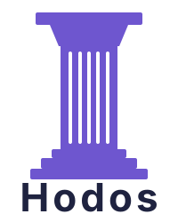

<div align="center">



<p><strong>ὁδός — "the path."</strong><br>
A learning harness for DeepSeek Harness: say what you want to learn, and the chat becomes a tutored session.</p>

<p>
  <a href="#install"><b>Install</b></a> ·
  <a href="docs/architecture.md"><b>Architecture</b></a> ·
  <a href="docs/security.md"><b>Security</b></a> ·
  <a href="docs/plugin-guide.md"><b>Plugins</b></a> ·
  <a href="https://github.com/AliSohani2082/Hodos/issues"><b>Issues</b></a>
</p>

<p>
  <a href="LICENSING.md"></a>
  
  
  
  
  
  
  
</p>

</div>

---

## Why Hodos?

Most people learn by being told things; far fewer by being checked, step by step, on what they actually understand. Hodos aims to give anyone a patient tutor for any topic: it finds where your understanding ends, plans the shortest route from there to your goal, teaches one step at a time, and only counts something as learned when a check you cannot talk your way past says so.

*Hodos* (ὁδός) is Greek for "way" or "path", and the root of "method" (*meta* + *hodos*, "the way after").

Hodos is a **learning harness**. It follows the process of [LearnHarness](https://github.com/amosblomqvist/learnharness) by amosblomqvist (probe, plan, teach, practise) and runs it inside [DeepSeek Harness](https://github.com/deepseek-ai/deepseek-harness) (DSH), the agent harness you already chat with.

### Why build it on DSH?

Every subject needs a different place to learn. Chess is learned on a board, Python by running code, algebra by writing expressions, a language by answering in it, and none of these fits a plain text chat. A fixed app would have to pick a few subjects and a single way of learning them.

DSH's plugin system removes that limit. Hodos supplies the learning process and the grading, and each **learning environment is a plugin** you choose: install the board for chess, the sandbox for code, or write your own for what you are studying ([plugin guide](docs/plugin-guide.md)). You also choose the model and the agent behind the tutor, so the setup adapts to your topic and to how you like to learn, not the other way round.

## What is Hodos?

Learning plugins for [DeepSeek Harness](https://github.com/deepseek-ai/deepseek-harness), following the process of [LearnHarness](https://github.com/amosblomqvist/learnharness). Tell the agent what you want to learn, on any topic ("I want to learn how knight forks win material"), and the chat becomes a learning session:

1. **Probe.** Graded questions find where your understanding ends on each idea the goal depends on.
2. **Plan.** The tutor draws a map of dependencies from what you know to the goal. It appears in the Hodos tab and shows where the lesson stands.
3. **Teach.** One step at a time: you predict, the tutor teaches, then a question checks that the step landed. Questions appear in the Hodos tab as multiple choice, an answer in your own words, or an interface from an installed plugin, such as a chess position to solve on a board or a Python sandbox.
4. **Knowledge graph.** What the tutor taught becomes ideas (propositions) and how they follow from each other (chains), in a second sidebar tab.
5. **Practice.** Pick ideas in the graph and practise them in a new chat, one problem at a time, with hints that escalate only as far as you need.

Hodos grades on the server. Choice questions and plugin exercises are graded deterministically (chess moves by the rules of chess, expressions by evaluating them), and their keys reach neither the browser nor, for exercises from installed courses, the model before you answer. Answers in your own words go to the tutor with the answer it committed before asking. On top of the LearnHarness process, Hodos keeps an estimate per plan node that only deterministically graded checks move, and schedules reviews.

The plugins are optional. Each adds ways of asking questions: `@hodos/chess` adds positions you solve on a board, `@hodos/code` a Python sandbox that runs in your browser, `@hodos/math` expressions, and `@hodos/language` typed answers in Spanish. Their prepared courses serve the tutor as banks of verified exercises.

**Status:** version 0.1.0, working with DeepSeek Harness 0.2.1-rc.3 and tested on Linux x64 with a scripted model in place of DeepSeek. The packages are not published to npm; install from this repository. See [known limitations](docs/limitations.md).

## What is included

| | |
|---|---|
| **Learning sessions** | Probe, plan map and teaching in any DeepSeek Harness chat, with questions answered in the **Hodos learning** sidebar tab |
| **Knowledge graph** | A **Knowledge graph** sidebar tab, filled from what the tutor taught through your default model, with notes import and deletion |
| **Practice** | Practice sessions on picked propositions, with the tutor's committed solution shown when a problem is concluded |
| **Interfaces** | Chess positions on an interactive board, a Python sandbox (Pyodide, in the browser), algebra expressions with formulas, and Spanish typed answers. Each is a separate plugin |
| **Plugin SDK** | MIT-licensed contracts for writing your own interface, as a DeepSeek Harness bundle or as a declarative plugin that runs no code in the host ([plugin guide](docs/plugin-guide.md), [sample plugin](examples/binary-numbers)) |
| **Question banks** | Courses shipped with the plugins, written with Claude Code and the `hodos course` command, or drafted by DeepSeek Harness through its Claude Code subagent. A course that did not ship with a plugin waits for your approval ([course authoring](docs/course-authoring.md)) |

## Install

You need a machine with Linux or macOS (other platforms are untested), `git`, and a model for the tutor configured in DeepSeek Harness (for DeepSeek, `DEEPSEEK_API_KEY`). Everything else is checked, and installed if missing, by the installer.

### Option 1: install.sh (recommended)

```sh
git clone https://github.com/AliSohani2082/Hodos.git
cd Hodos
./install.sh
```

Or in one line: `curl -fsSL https://raw.githubusercontent.com/AliSohani2082/Hodos/main/install.sh | bash`. Read the script first if you prefer; it is short.

The script:

1. checks for **Node.js 24.9+** (offers to install it with nvm), **pnpm**, and **DeepSeek Harness** (`@deepseek-ai/dsh`), and installs what is missing;
2. builds Hodos and installs the core plugin, `@hodos/dsh`, into the `web` profile;
3. asks which **complementary plugins** you want: chess, code, math, language, and the Claude Code, Codex and ACP subagent providers.

For no questions, run `./install.sh --yes` (core plugin and chess) or choose plugins yourself with `./install.sh --plugins chess,code,math`. `./install.sh --help` lists the other options.

### Option 2: install manually

You need Node.js 24.9 or later, pnpm, and DeepSeek Harness 0.2.1-rc.3 or a later 0.2 release.

```sh
pnpm install
pnpm build
dsh plugin --profile web add "$PWD/packages/dsh-adapter"
dsh plugin --profile web add "$PWD/packages/environments/chess"   # optional: any of chess, code, math, language
dsh web
```

The [install guide](docs/install.md) covers the other plugins, tarball installs, configuration and your data.

### Self-host on your own server

Hodos has no separate server: it is a set of DSH plugins, so hosting it means running `dsh web` on a machine you control (a VPS or a home server).

1. Install on the server with either option above.
2. Start `dsh web` (run `dsh web --help` for its address and port options), under a process manager such as systemd or `tmux` so it survives logouts.
3. Put a reverse proxy with TLS **and authentication** in front of it. Do not expose it to the internet as it is: the tutor runs on your model key.
4. Back up `$DSH_HOME/hodos` (default `~/.dsh/hodos`). It holds every learner's sessions, knowledge graph and mastery estimates in SQLite.

### Use it

Tell the agent what you want to learn and open the **Hodos learning** tab in the right sidebar; the **Knowledge graph** tab is listed next to it.

To turn a plugin off but keep it installed, put a row like this in the profile's patch list, `$DSH_HOME/profiles/web/cordis.patch.yml` (`$DSH_HOME` defaults to `~/.dsh`; the file starts as an empty list, `[]`, which the row replaces), and restart:

```yaml
- id: hodos-chess
  disabled: true
```

To uninstall (your learning records in `$DSH_HOME/hodos` stay until you delete them):

```sh
dsh plugin --profile web remove @hodos/chess
dsh plugin --profile web remove @hodos/dsh
```

## Recommended plugins

Hodos's own interfaces are in [What is included](#what-is-included). These DSH plugins work alongside it:

| Plugin | What it does for Hodos |
|---|---|
| **Claude Code subagent** (`@deepseek-ai/dsh-subagent-claude-code`) | Connects your Claude Code sign-in to DSH, so `hodos_draft_course` can draft question banks through Claude. Tested end to end against a local stand-in for Anthropic's API; setup and the sign-in rules are in [course authoring](docs/course-authoring.md#drafting-in-deepseek-harness-with-claude). |
| **Codex subagent** (`@deepseek-ai/dsh-subagent-codex`) | The same idea through Codex. Not yet tested with Hodos. |
| **ACP subagent** (`@deepseek-ai/dsh-subagent-acp`) | Drives any agent that speaks the Agent Client Protocol (Gemini CLI, OpenCode and others) as a subagent. Not yet tested with Hodos. |

Hodos never handles these tools' credentials: whatever they are signed in with stays inside them. `install.sh` offers all three.

## Develop

| Command | What it does |
|---|---|
| `pnpm install` | Install dependencies (pnpm workspace) |
| `pnpm build` | Compile the packages, the workspace app, the DSH browser half and the renderers |
| `pnpm typecheck` | Type-check Node, browser and test code |
| `pnpm lint` | [oxlint](https://oxc.rs) with type-aware rules; the policy is in [`.oxlintrc.json`](.oxlintrc.json) |
| `pnpm test` | Unit and integration tests, offline and without keys |
| `pnpm test:security` | Only the tests named "security" |
| `pnpm test:e2e` | Builds, then runs the browser tests and the DeepSeek Harness tests; set `HODOS_DSH_BIN` to the `dsh` launcher, or the Harness tests are skipped |
| `pnpm verify:puzzles` | Check the chess puzzles with a UCI engine (`--engine <path>` or `HODOS_STOCKFISH`); `--write` records the result |
| `pnpm verify:snippets` | Run every Python program of the code course under CPython (`HODOS_PYTHON`, default `python3`); `--write` records the result |
| `pnpm pack:dsh` | Build installable tarballs into `dist-packages/` (nothing is published) |
| `pnpm clean` | Remove build output |

Optional environment variables for the tests:

- `HODOS_STOCKFISH` (a Stockfish binary) and `HODOS_PYTHON` (a CPython interpreter) turn on two live checks in `pnpm test`.
- `HODOS_E2E_CLAUDE_CODE=1` adds the Claude Code drafting test to `pnpm test:e2e`. It installs DSH's Claude Code bundle from npm and runs it against a local stand-in for Anthropic's API.
- `HODOS_E2E_SCREENSHOTS=<dir>` saves screenshots of the learning-session test.

The end-to-end tests use a scripted model and throwaway Harness homes. They need no API key and do not touch `~/.dsh`.

## Documentation

| Document | |
|---|---|
| [Architecture](docs/architecture.md) | Packages, the runtime picture, a learning session step by step, the knowledge graph, practice, mastery, storage |
| [Install guide](docs/install.md) | Installing into DeepSeek Harness, configuration, data, removal |
| [Security notes](docs/security.md) | Trust boundaries, plugin tiers, the sandbox, answer keys, and what is not covered |
| [Known limitations](docs/limitations.md) | What this release does not do or has not been shown to do |
| [Plugin guide](docs/plugin-guide.md) | Writing an environment plugin |
| [Course authoring](docs/course-authoring.md) | Writing and drafting courses, with Claude Code or in DeepSeek Harness |
| [DSH compatibility report](docs/dsh-integration/compatibility.md) | Every DeepSeek Harness API Hodos uses, and how it was verified |
| [ADRs](docs/adr/README.md) | Architecture decisions; [ADR-0007](docs/adr/0007-learning-harness-on-dsh.md) is the move to LearnHarness's process |
| [PRD](docs/PRD.md), [threat model](docs/hodos-threat-model.md) | The original product requirements and the threat model of that design |
| [Security and product review](docs/reports/2026-11-02-security-and-product-review.md) | A whole-codebase security review (method, candidate findings and their scores, the fixes made, what was checked and found sound) and a review of the product against the PRD and ADR-0007 |
| [Learning-harness report](docs/reports/2026-10-27-learning-harness-report.md) | The redesign around LearnHarness's process: what changed, the tests run with their results, defects found, gaps and the next step |
| [MVP report](docs/reports/2026-10-27-mvp-report.md) | The first release, built around prepared courses (superseded by the redesign) |

## Licensing

The core, the DSH adapter and the workspace are AGPL-3.0 ([`LICENSE`](LICENSE)). The plugin SDK, the testing kit and the environments are MIT ([`LICENSE-MIT`](LICENSE-MIT)), so plugin authors take on no AGPL obligations. See [`LICENSING.md`](LICENSING.md).
