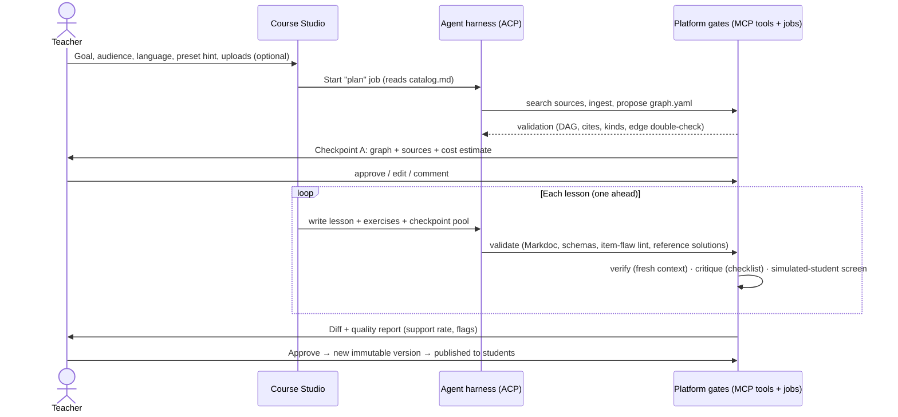
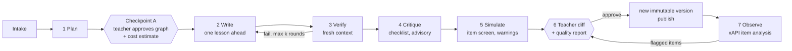
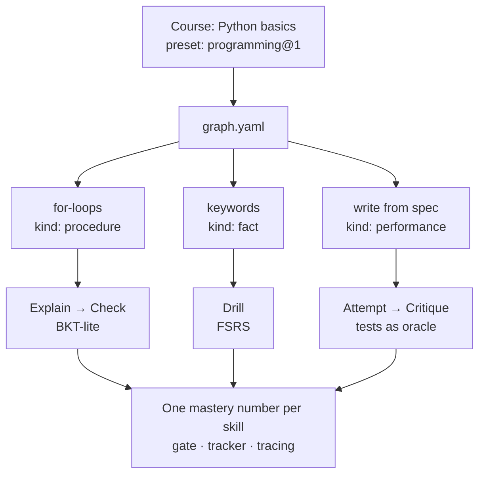
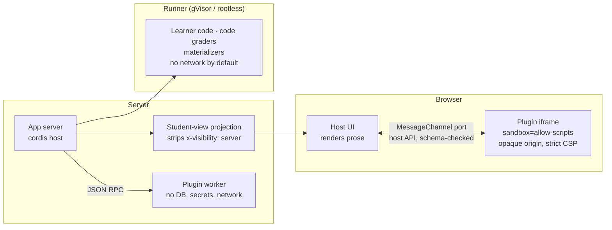
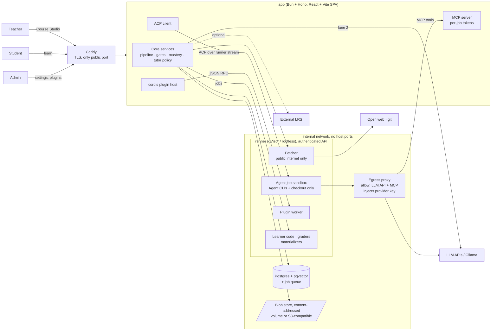
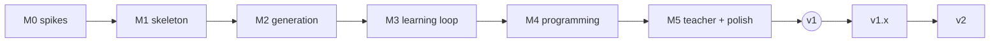

# Hodos: Product Requirements Document

| | |
|---|---|
| **Status** | Draft v0.2 (threat-model fixes applied), ready for review |
| **Date** | 2026-10-10 |
| **Owner** | Project author |
| **Decided in** | Design interview, 2026-10-09/10 (decision log in [Appendix A](#appendix-a-decision-log)) |
| **Research** | [`docs/research/lesson-ir.md`](research/lesson-ir.md) · [`docs/research/intelligent-tutoring.md`](research/intelligent-tutoring.md) · [`docs/research/agentic-its-landscape.md`](research/agentic-its-landscape.md) |
| **Security** | [`docs/hodos-threat-model.md`](hodos-threat-model.md). Its fixes are applied below and tagged with threat IDs (TM-xxx). |
| **License** | Core: AGPL-3.0. Plugin SDK, contracts and reference plugins: MIT. |

Items marked **(default)** were not explicitly discussed. They are reasonable defaults and can be changed without reopening other decisions.

---

## 1. Summary

Hodos is a **self-hostable, open-source platform where a teacher steers any AI coding agent to build a course, approves it like a pull request, and students learn from it with a mastery model the platform guarantees.**

- A teacher describes a goal in the **Course Studio**.
- An AI agent harness (Claude Code, Codex, Gemini CLI, OpenCode… over the Agent Client Protocol) does the planning, the research and the writing, using Hodos's tools over MCP.
- The platform owns the pipeline and its quality gates. The teacher approves the skill graph first, then a diff of the finished draft.
- Students start with an adaptive diagnostic that finds what they already know. They then learn through lessons, practice, gated checkpoints and spaced review, inside per-course **plugins**: a code editor, a chessboard, a manim lecture player, a drawing canvas.
- Each student gets an automatic **adaptive layer** on top of the approved course. The teacher sees everything in simple tracing views.

The project is inspired by [amosblomqvist/learn](https://github.com/amosblomqvist/learn), a single-learner teaching setup for the `pi` agent, and grows it into a multi-role web platform with a plugin system, so that anything can be learned with it.

### 1.1 Positioning

Generating courses with AI is now commodity. [DeepTutor](https://github.com/HKUDS/DeepTutor) (Apache-2.0, ~41k★) and [OpenMAIC](https://github.com/THU-MAIC/OpenMAIC) (MIT, ~40k★) both generate courses, and both can call Claude Code or Codex. Hodos competes on four things that no current project combines:

1. **A versioned, teacher-approved course blueprint**, reviewed structure-first and then as a diff, with immutable versions stored in Postgres.
2. **A platform-owned mastery model** behind typed learning loops, so "mastered" means the same thing in every course and in one global skill graph per learner.
3. **Sandboxed exercise plugins with server-side graders and secret answer keys.**
4. **Class-level tracing** for the teacher.

Lead with these four, not with "AI makes courses". (See [§17](#17-similar-projects) and `agentic-its-landscape.md` §6.)

---

## 2. Goals and non-goals

### 2.1 Goals (v1)

| # | Goal | Measured by |
|---|---|---|
| G1 | A teacher goes from a goal to a published, cited, gated course with little effort | Time to first published course; the teacher's edit rate on drafts |
| G2 | Students actually learn: mastery is real, not inflated by hints or guessing | Opportunities-to-mastery per skill, checkpoint first-pass rate, review lapse rate (§13) |
| G3 | Generated content is trustworthy | Citation support rate, answer-key disagreement = 0 in checkpoint pools, flagged-item rate |
| G4 | It works for genuinely different subjects through plugins | Three presets ship in v1 (programming, conceptual, memorization); the reference plugins run sandboxed |
| G5 | Anyone can self-host it on one machine, safely exposed to the internet | One `docker compose up` with secure defaults (DP-1); backup is `pg_dump` plus the blob store, with the secrets key backed up separately |
| G6 | Any agent harness works | Course generation passes with at least two ACP agents (e.g. Claude Code and Codex) |

### 2.2 Non-goals (v1)

- Running as a hosted, multi-tenant SaaS for many untrusted organizations.
- Replacing a school's LMS. Hodos is a supplement the teacher steers, and LTI embedding comes in v1.x.
- Neural or deep knowledge tracing, emotion detection, or proctoring.
- Fully autonomous publishing with no human approval.
- AI generating plugin code while it builds a course. New plugins only come through the Plugin Forge.
- Native mobile apps. The web UI should still be usable on mobile.

---

## 3. Users and roles

Roles are enforced by role-based access control. **One person can hold all three roles.** The most common install will be a single self-learner who is admin, teacher and student at once.

| Role | Can do | Typical person |
|---|---|---|
| **Admin** | Install and remove plugins (registry, hub, Plugin Forge), connect AI providers and agent harnesses, set spend caps, manage users | The person who runs the server |
| **Teacher** | Create and steer courses in the Course Studio, approve Checkpoint A (the graph) and the final diffs, publish versions, set guardrails, view tracing, review the flagged-item queue | A tutor, a parent, a small-class teacher, a team lead, or a self-learner |
| **Student** | Take the diagnostic, learn, practice, take checkpoints, review; see their own mastery map; export or delete their own data | A learner |

**Personas**
- **Sam, the self-learner (all three roles):** wants to learn Rust properly. Approval can be set to automatic. Sam cares about honest mastery and low cost.
- **Dana, the tutor (teacher + admin):** runs a coding club for 12 teenagers. Dana needs the approval flow, the class overview and the item analysis.
- **Priya, the plugin author:** builds a "circuit simulator" exercise plugin and lists it on the hub.

---

## 4. Core concepts

| Term | Meaning |
|---|---|
| **Skill graph** | A directed acyclic graph (DAG) of skills with prerequisite edges. There is **one global, personal graph per learner** in the database. A course is a goal node plus a path through that graph from the learner's current frontier, so knowledge carries over between courses. Mermaid is only an export format. |
| **Kind** | The type of knowledge a skill node is: `fact`, `concept`, `procedure`, `pattern`, `performance` or `judgment`. The kind picks the node's learning loop. |
| **Learning loop** | One of four teaching-and-assessment cycles owned by the platform (§7). Each has its own mastery estimator and gate rule. |
| **Preset (course type)** | Data, not code. It maps kinds to loops and declares the required plugins, a lesson template and tutor settings. Plugins can ship presets. |
| **Blueprint** | The teacher-approved, versioned course: `course.yaml`, `graph.yaml`, `catalog.md`, lessons, checkpoint pools and notes. Stored as documents in Postgres with immutable, content-addressed versions (§9.2). It can be exported to and imported from a git repo. |
| **Checkout** | A throwaway file copy of a course draft, created for one agent job and mounted into that job's sandbox (AI-7) so the agent can read, grep and edit natively. Only paths in the course path schema are imported back, through the validator, in one transaction. Then it is deleted. |
| **Agent job sandbox** | The isolated container one agent job runs in: only its checkout mounted, no app secrets, egress only to the LLM API and the platform's MCP endpoint (AI-7). The agent CLIs never run inside the app container. |
| **Adaptive layer** | Per-student additions on top of a blueprint version: diagnostic skips, remedial segments, re-explanations, practice items. They run automatically within the teacher's guardrails, are logged, and are stored as overlay rows in the database. |
| **Source / outlet** | A credible resource (article, docs page, paper, video transcript, an uploaded book). It is linked many-to-many to skills, tagged with a perspective, split into chunks and embedded, and cited per claim. |
| **Lesson IR** | The presentation-agnostic lesson text: Markdoc with typed blocks contributed by plugins. **Plugins decide how it looks.** |
| **Block / materializer** | A block is a typed lesson element (`perspective`, `position`, `animation`…). A materializer is an expensive render job (manim video, text-to-speech audio) that runs in a container and is cached by content hash. |
| **Exercise / mode** | One exercise contract run in **Practice** (optional, unlimited, hints), **Checkpoint** (the gate: no tutor, no hints) or **Review** (spaced repetition). |
| **Catalog** | `catalog.md`, a document in the blueprint: the teacher's persistent preferences (tone, level, house rules, banned topics, exemplars). Every agent run reads it. Only the teacher writes it; agents can only propose changes (CS-10). |
| **Lanes** | The ways the platform reaches AI: (1) the agent harness over ACP, (2) the direct LLM for hot-path calls, and (3, later) a built-in agent pipeline. |

---

## 5. User journeys

### 5.1 Teacher creates a course



### 5.2 Student takes a course

1. Enroll, then take the **diagnostic**: about 15 questions, at most 25. It can be skipped, and redone once a week.
2. The **mastery map** shows point A, the goal (point B) and the path between them.
3. **Lesson:** rendered by the course's layout plugin. Lesson chat is available, with cited answers.
4. **Practice** (optional): unlimited items, a hint ladder, a mix that adapts.
5. **Checkpoint:** no tutor and no hints. Passing opens the next skill. Failing triggers the adapt pass, which inserts a remedial segment or a remedial lesson.
6. **Review:** FSRS schedules skills before they decay. Each review uses a fresh item variant.
7. Lesson N+1 was already drafted while the student studied lesson N, so there is no waiting in the common case.

### 5.3 Admin installs a plugin

Browse the hub (or paste an npm name) → read the manifest: the permissions it asks for, the blocks, exercises and presets it contributes, its license and npm provenance → install an exact version, checked against its integrity hash, with install scripts disabled. Anything unlisted needs an explicit "install untrusted" confirmation. Updates are never automatic: the admin sees a manifest diff first. Plugins can also come from the **Plugin Forge** (§8.6), always at the untrusted tier.

---

## 6. Functional requirements

Priorities: **P0** is needed for v1, **P1** is v1 if time allows (otherwise v1.x), **P2** is later.

### 6.1 Course Studio and generation pipeline

The **agent owns drafting and the platform owns the gates.** Every gate is an MCP tool or a platform job, so every harness hits the same checks.



| ID | Requirement | Pri |
|---|---|---|
| CS-1 | The Course Studio is a chat-plus-canvas workspace. The teacher talks to the agent, sees the live graph, lessons streaming in, and job progress. | P0 |
| CS-2 | Intake collects the goal, audience, course language, preset (proposed by the agent, confirmed by the teacher), budget, and optional uploads. | P0 |
| CS-3 | **Plan** produces `graph.yaml`: nodes, `kind`, `requires` edges, objectives, linked sources. Gates: the graph is acyclic; every node has at least one cited chunk; kinds are allowed by the preset; every prerequisite edge is confirmed by a second pairwise query (pairs that come out bidirectional or ambiguous are dropped); a graph-size budget. | P0 |
| CS-4 | **Checkpoint A:** the teacher approves the graph, the sources and a **cost estimate** before any lesson is written. | P0 |
| CS-5 | **Write** produces Markdoc lessons, exercise envelopes and checkpoint pools. Gates: Markdoc validation with a repair loop, schema checks, every reference resolves, a rule-based item-flaw lint, and the plugin's `validateItem` (for example, the reference solution passes its tests). | P0 |
| CS-6 | **Verify** runs in a **fresh context**, on a **different model family** when the admin has configured one. Each claim is checked against its cited chunk (entailment), and each answer key is re-solved N times. Any key disagreement in a checkpoint pool **blocks**. The rest are flags. | P0 |
| CS-7 | **Critique:** a binary checklist taken from the preset (for example: ends with retrieval items, includes a worked example for procedures, hints don't leak answers, reading level, objective coverage). Advisory only. | P0 |
| CS-8 | **Simulated-student screen** for checkpoint pools: small-model students with set knowledge profiles flag items that are guessable, ambiguous, wrongly keyed, or whose misconception tags don't trigger. Warnings only, never a score. | P0 |
| CS-9 | The **diff view** sorts flagged items first and supports batch-approving clean ones. Risky elements (CS-13) and changes to `catalog.md` or notes are always flagged and **can't be batch-approved**. Comments anchor to block IDs, so one block can be regenerated without regenerating the lesson. | P0 |
| CS-10 | `catalog.md` holds persistent teacher preferences that every run reads. It is **teacher-write-only**: the agent can propose a change (for example, distilling recurring edits), which appears as a flagged item in the diff. Catalog and notes from an imported course are shown to the teacher as untrusted until approved (TM-004). | P0 |
| CS-11 | The teacher can say "fix this" from item analysis or the flagged queue. This starts a draft for a new version. | P1 |
| CS-12 | Auto-approve only while the instance has **exactly one account** (teacher = student), still logged. The condition is re-checked at every approval, and auto-approve switches off automatically when a second account is created (TM-006). | P0 |
| CS-13 | **Risky-element gate (T0):** every external URL, shell command, package install, download link and credential prompt in generated content is extracted and shown as its own flagged item. Each course keeps a domain allowlist built from its approved sources. Link destinations are always shown in full to students. Overlays and lesson chat can't introduce a URL or package that isn't already in the approved version; anything new is stripped and the teacher is alerted (TM-006). | P0 |

### 6.2 Diagnostic ("binary search" of what the learner knows)

| ID | Requirement | Pri |
|---|---|---|
| DG-1 | A **Bayesian half-split** over down-sets of the scoped skill DAG (knowledge space theory, ALEKS-style), using about 3,000 particles. Each next question targets the node whose estimate is closest to 50%. | P0 |
| DG-2 | The scope is the goal's ancestors, minus nodes the learner's global graph already knows with confidence ≥ 0.8. A second course therefore starts warm. | P0 |
| DG-3 | Stop when the expected per-node error is below 5%, with at least 5 questions and at most 25, plus a fatigue rule. In simulation this averaged about 15 questions and about 93% per-node accuracy on graphs of 30–120 nodes (`intelligent-tutoring.md` §4). | P0 |
| DG-4 | An "I don't know" button removes guessing. No hints. Answers are never shown, so items stay reusable. | P0 |
| DG-5 | Kind-specific placement: a sample of cards for `fact` nodes, Elo placement for `pattern` and `judgment` (v1.x), one or two short prompts for `performance`. | P0 / P1 |
| DG-6 | Skippable ("start from scratch") and redoable at most once a week. Students can also test out of any lesson by taking its checkpoint. | P0 |

### 6.3 Mastery model

One contract, several estimators. Every skill exposes `pMastered`, a confidence, a retrievability `R(t)` and a review due date. **Estimators, gate rules and tutor limits belong to the platform. Plugins contribute evidence and configuration, never the inference.**

| ID | Requirement | Pri |
|---|---|---|
| MS-1 | **BKT-lite** for `concept` and `procedure`. Guess and slip are adjusted for item difficulty. Evidence is soft, a score in [0,1]. A **hint discount** applies: `e = x·(1−h)`, so a correct answer after the bottom-out hint counts as a failure. Multi-skill blame is split conjunctively. A per-mode learning rate λ: practice 1.0, review 0.5, checkpoint 0. The formulas are in `intelligent-tutoring.md` §3.2. | P0 |
| MS-2 | **Gate:** `P(L) ≥ θ`, plus at least one *unassisted* correct checkpoint answer, plus attempts on at least 3 distinct items. θ is shown to teachers as lenient / standard / strict = 0.90 / **0.95** / 0.98. | P0 |
| MS-3 | **FSRS** (`ts-fsrs`) per skill for Review, always with fresh item variants. Item-level FSRS for `fact` nodes. Effective mastery is `pMastered · R(now)`. A prerequisite whose R falls below 0.7 is reviewed before any lesson that depends on it. | P0 |
| MS-4 | An **oracle-rubric** estimator for loop-4 nodes with deterministic graders, e.g. "functional correctness" gated by tests passing on at least 2 distinct specs. | P0 |
| MS-5 | **Elo** for `pattern` and `judgment` nodes: decaying K, lagged θ during item selection, item difficulty calibrated across the instance. | P1 (with chess) |
| MS-6 | A **calibrated AI-rubric** estimator (anchor sets, leave-one-out agreement, dimensions with poor agreement stay advisory). | P2 (with drawing) |
| MS-7 | **Shadow mode:** a new estimator or adapt policy logs its predictions next to the live ones before it takes over. | P1 |
| MS-8 | Every adaptive decision stores a "why this item" rationale that the teacher can see. | P0 |

### 6.4 Lessons

| ID | Requirement | Pri |
|---|---|---|
| LS-1 | Lessons are **Core + Perspectives**: one coherent core explanation with claims cited inline, plus perspective segments showing how specific outlets frame the same thing. "Perspective" is a *semantic role*. The layout decides how it appears (a card, a narrated aside, an alternative line on a board…). | P0 |
| LS-2 | The IR is **Markdoc**, validated against JSON Schemas registered by plugins, and stored in Postgres as source text plus a parsed, syntax-neutral JSON tree (`jsonb`). The text is authoritative and the tree is re-derived from it. Markdoc is **provisional** until the M0 reliability eval (§14). | P0 |
| LS-3 | Exactly **one layout plugin** per course. Block plugins fill the layout in. A **plain-text fallback renderer** always works. Every block declares a `fallback.text` projection, which also feeds transcripts, text-to-speech and search. | P0 |
| LS-4 | Streaming: prose renders progressively. Plugin blocks mount only once they are closed and valid. | P1 |
| LS-5 | Stable block IDs are stamped into the text once. Text is never auto-reformatted. **Every write goes through the validator in a transaction**, whether it comes from MCP tools, a checkout import or the in-app editor, so invalid content never reaches the database. | P0 |
| LS-6 | Materializers (manim, text-to-speech) run in the runner. The cache key is the hash of plugin ID, plugin version, block schema version, block content and relevant config. Until the output is ready, the fallback is shown. | P1 |
| LS-7 | **Lesson chat** answers questions with citations. It is a plain lane-2 LLM call, not a tool-using agent: the server assembles its context (the current lesson, retrieved chunks from this course's sources, and the *current* student's learner context through the student-view projection in EX-2). It has no tools, so it can't ask for another student's data (TM-008). It refuses to solve the item the learner is currently being graded on, and it can't introduce new links or packages (CS-13) **(default)**. | P0 |
| LS-8 | Only formative "check-understanding" items appear inline in lessons. Checkpoint items live in `checkpoints/` pools. | P0 |

### 6.5 Exercises, modes and the tutor

| ID | Requirement | Pri |
|---|---|---|
| EX-1 | **Exercise contract** (`intelligent-tutoring.md` §6). The platform owns the envelope: `id`, `isomorphGroup`, weighted skills, kind, cognitive level, `difficulty.b`, scaffold, modes, `hints[1..5]`, distractors with misconception tags, steps, rubric reference, `cites`, `provenance`. The plugin owns the payload and `grade()`. | P0 |
| EX-2 | **Answer keys are server-only.** Schema fields marked `x-visibility: server` (keys, tests, rubrics, distractor rationales) are stripped before anything reaches the browser. Stripping happens in **one student-view projection function** that every student-bound path uses: API serializers, iframe payloads, data export, LRS forwarding, chat context and error messages. It has its own tests, and canary strings in keys trigger an alert if they ever appear in a student-bound response (TM-011). Hint and feedback text have release timing (`on-hint:n`, `after-attempt`, `after-grade`). Grading always happens server-side. **In Checkpoint mode the platform returns only the score until the release event and ignores plugin feedback**, whatever the plugin's `revealsAnswer` flag says. | P0 |
| EX-3 | **Tutor policy per mode** is enforced by the platform: Practice has a rate-limited L1→L5 hint ladder; Checkpoint and Diagnostic have no tutor at all; Review offers one re-explanation after a failure; help is proactive when a learner is stuck (3 or more wrong answers, or 2 minutes idle). Self-learners may raise the hint limit in Practice, and the evidence discount still applies. | P0 |
| EX-4 | Hint levels L1–L2 are written in advance. L3–L5 are generated on demand and verified (by solver or self-consistency) before they are shown. | P0 |
| EX-5 | **Run vs submit:** for oracle-graded exercises, the learner can run tests freely, but only submissions count as evidence. Many failed runs count a little like hint use. Runs use **practice tests only**. Checkpoint tests are a separate set that runs only on submit, and run output shows only public test names and truncated output (TM-007). | P0 |
| EX-5b | **Grader isolation:** the reference solution never enters the learner's sandbox. Hidden tests run in a separate process, under a different uid from learner code, and the harness reports results through a channel learner code can't write (exit status collected by the parent plus a per-run nonce). I/O tests whose expected output is compared outside the sandbox are preferred. Inputs are randomized per attempt where the item allows it. Submissions that pass after zero passing runs, or whose output contains test source, are flagged for the teacher (TM-007). | P0 |
| EX-6 | The session builder targets a practice success rate (default 0.7–0.8), interleaves confusable skills once their first exposures are done, and uses worked → faded → independent scaffolding based on `P(L)`. | P0 |
| EX-7 | Built-in, no-code exercise kinds: MCQ, short answer (rubric, low weight), numeric, cloze, flashcard. Response vocabulary and declarative scoring templates are borrowed from QTI 3. | P0 |
| EX-8 | An accessibility-catalog field (alt text, glossary, read-aloud) is **reserved** in the envelope now. | P0 (field) / P2 (feature) |

### 6.6 Sources and retrieval

| ID | Requirement | Pri |
|---|---|---|
| SR-1 | Sources are first-class entities: many-to-many with skills, annotated with coverage, depth and a **perspective tag**, owned by the learner or instance and reused across courses. | P0 |
| SR-2 | **Ingest policy:** open web content (articles, docs, papers, Wikipedia, open textbooks, video transcripts) is cached privately for retrieval, like a read-later app. Copyrighted books enter **only through the user's own uploads**. Cached content is **never** exported, shared or published to the hub. The agent must never fetch from shadow libraries. | P0 |
| SR-3 | **Hybrid retrieval in Postgres:** pgvector plus full-text search, merged with reciprocal-rank fusion. No external vector database. | P0 |
| SR-4 | **Multilingual:** sources in any language, multilingual embeddings, citations showing the original passage plus a translated excerpt. | P0 |
| SR-5 | Chunk IDs are immutable. If a source is re-chunked, a chunk-to-chunk remap is kept. The retrieval set shown to the agent for each generation is stored with the lesson, so validation can be reproduced. | P0 |
| SR-6 | A per-lesson **citation support rate** is shown in the diff, listing unsupported claims. | P0 |
| SR-7 | A retrieval regression check (Recall@k, nDCG on a small labeled set) in CI, borrowed from DeepTutor's `kb eval`. | P1 |
| SR-8 | **Fetcher policy (TM-005).** All web and git access goes through one platform fetcher that runs in a runner sandbox (fetcher profile, §9.4); neither the app nor the agent fetches directly. https only (http is an admin opt-in). DNS is resolved first; private, loopback, link-local, CGNAT and IPv6 ULA addresses are blocked, and the connection is pinned to the checked IP. Every redirect is re-checked; redirects, response size and time are capped; content types are allowlisted. Git: https transport only, no submodules or LFS, shallow clone with a size cap, then through the course validator (VC-1b). PDF, EPUB and HTML are parsed inside the sandbox and only extracted text is stored. Every fetch destination is logged. | P0 |
| SR-9 | Cached sources are shown to users as **extracted text only**, never as the original HTML (TM-010). | P0 |

### 6.7 Versioning and the adaptive layer

| ID | Requirement | Pri |
|---|---|---|
| VC-1 | **Versions live in Postgres, using git's model with foreign keys.** Content is stored as immutable, content-addressed `blobs` (hash → text). `course_versions` records the parent, the approver and a tag. `version_entries` maps (version, path) to a blob hash. The draft is a mutable working set. Approval freezes it into a new version in one transaction. Students read an immutable version, never the draft. Diffs are computed in the app. Linear history in v1, with no branching UI. | P0 |
| VC-1b | **Agent checkouts:** for each agent job, the draft is exported to a throwaway directory (plain files, no `.git`) that is mounted into the job's sandbox (AI-7). After the job, only paths in the **course path schema** are imported, through the validator, in one transaction. Symlinks, hooks, binaries and unknown files are ignored and listed in an import report. The directory is then deleted. MCP content tools (`lesson.read`, `lesson.write`, `lesson.validate`) are an alternative path. | P0 |
| VC-1c | **One validator for every content write (TM-004).** Checkout import, git import (SH-2), MCP content tools and the in-app editor all go through the same validator and the same fixed path schema: `course.yaml`, `graph.yaml`, `catalog.md`, `index.md`, `log.md`, `lessons/*.md`, `checkpoints/*`, `notes/*.md`. Nothing else is ever stored, so agent configuration files (`.mcp.json`, `CLAUDE.md`, `GEMINI.md`, `.codex/`, `opencode.json`, CLI settings with hooks) can never enter a course. **`AGENTS.md` is not stored**: it is rendered fresh into each checkout from platform templates and the enabled plugins' guidance, and is never imported. Agent writes to `catalog.md` are turned into a proposal (CS-10). | P0 |
| VC-2 | `course.yaml` pins plugin versions and block-schema versions for each published version. Schema migrations run only when a draft becomes a new version, never on load. | P0 |
| VC-3 | Per-student overlays are keyed by (student, course version, block ID) and validated by the same pipeline, including the risky-element gate (CS-13): an overlay can only link to URLs and packages already in the approved version. | P0 |
| VC-4 | When a new version changes the block an overlay is anchored to, the overlay is dropped and regenerated if it's still needed **(default)**. | P1 |
| VC-5 | Students move to a new version at the next lesson boundary, and their mastery carries over **(default)**. | P0 |

### 6.8 Tracing and teacher dashboards

| ID | Requirement | Pri |
|---|---|---|
| TR-1 | One **append-only, xAPI-shaped event log** (actor, verb, object, result, context including course version, skills, plugin and the adaptive change) for learner events **and** AI generation runs (tokens, cost, latency, failures, sources used, every agent tool call and permission decision). Append-only is enforced by the database: the app's role has no `UPDATE` or `DELETE` on the event, blob and version tables. Actors are pseudonymous IDs with a separate, deletable mapping table, so account deletion (AU-3) erases the person without breaking the log (TM-016). | P0 |
| TR-2 | **Class overview:** students × courses, showing progress, current lesson, last active, checkpoint pass rate, and a "stuck" flag (failed the same checkpoint twice, or 7 days inactive mid-course). | P0 |
| TR-3 | **Student mastery map:** the skill graph colored by one student's mastery, plus a class-average view, with "why this item" rationales. | P0 |
| TR-4 | **Item analysis:** most-failed checkpoint items, item p-value and discrimination, hint and bottom-out rates, lessons with low pass rates. Each links to "fix this" (CS-11). | P0 |
| TR-5 | Students see their own map and progress, never class data. | P0 |
| TR-6 | Optional forwarding of events to an external Learning Record Store (LRS). | P1 |
| TR-7 | A spend view (cost by course, job and student), drawn from the same log, with per-student anomalies highlighted. | P0 |
| TR-8 | **Admin audit trail:** plugin installs and updates (with integrity hash), role changes, enrollments, auto-approve toggles, cap changes, secret changes, harness settings and approvals are logged as audit events (TM-016). | P0 |
| TR-9 | **Security alerts** to the admin: denied egress from an agent job, MCP calls outside a job's scope, blocked internal fetch targets, risky elements stripped from overlays or chat, canary-string hits, new admin-role grants, repeated failed logins (TM-001, TM-005, TM-006, TM-011, TM-002). | P1 |

### 6.9 AI lanes, credentials and spend

| ID | Requirement | Pri |
|---|---|---|
| AI-1 | **Lane 1, agent harness:** the platform is an ACP client and drives Claude Code, Codex, Gemini CLI, OpenCode and others. The CLIs are installed in a separate **agent sandbox image**, never in the app image, and each job runs in its own sandbox (AI-7). A consumer CLI login is allowed **only while the instance has exactly one account**. Multi-account instances must use a dedicated, spend-capped API key, since serving other people from a consumer subscription is likely against provider terms and that token is the most valuable secret on the box. | P0 |
| AI-2 | The platform exposes its domain as an **MCP server** (e.g. `graph.propose`, `sources.search`, `sources.fetch`, `lesson.validate`, `item.validate`, `learner.context`, `job.report`). **Caller identity always comes from the token, never from tool arguments** (TM-008). Each agent job gets a per-job MCP token bound to (job, course draft, teacher) that expires when the job ends; tools reject IDs outside that scope and log the attempt. `learner.context` is not exposed to generation jobs at all (AI-8). | P0 |
| AI-3 | **Lane 2, direct LLM:** an OpenAI-compatible or Anthropic API key, or a local model (Ollama), for grading, drill generation, adapt passes, verification, the simulated screen and embeddings. | P0 |
| AI-4 | **Lane 3, built-in agent pipeline** (LangGraph.js or similar), running the *same* pipeline stages for users without an agent CLI. | P2 |
| AI-5 | **Spend control:** every job shows a cost estimate before it runs; large jobs need teacher approval; monthly caps per instance, per course and per student; behavior when a cap is hit is configurable (pause or degrade to a local model). The teacher's generation budget is **reserved separately** from the student-triggered pool, so students can't exhaust it. Alerts at 50% and 80% of each cap. | P0 |
| AI-5b | **Per-student rate limits (TM-012):** token buckets on chat, hint generation, practice-item generation and test runs. The adapt pass is debounced to once per skill per student per day and reuses an existing overlay when one fits. Generated variants and L3–L5 hints are cached per item and reused across students. | P0 |
| AI-6 | Harness sessions run with a platform-set permission policy. The working directory is the job's throwaway checkout (VC-1b), tools are allowlisted, and the agent's permission requests are answered by policy. **These are defense in depth, not the boundary:** they are enforced by the agent process itself, which a prompt injection controls. The boundary is AI-7. | P0 |
| AI-7 | **Agent job isolation (TM-001, critical).** Every lane-1 job runs in its own container from the runner's agent-job profile (§9.4): gVisor or rootless, non-root, CPU, memory and time limits. **Only that job's checkout is mounted.** No app environment variables, no database or blob credentials, no secrets key, no other checkouts. **Egress is default-deny** through a proxy that allows only the configured LLM API host(s) and the platform's MCP endpoint; all web access goes through the platform fetcher via the `sources.fetch` MCP tool (SR-8). The provider credential is **injected at the proxy** when the CLI supports a custom base URL, so the sandbox never holds it; otherwise the sandbox gets the dedicated, spend-capped key from AI-1. Each CLI is launched with project and user config discovery disabled and an explicit MCP config (the exact flags per CLI are verified in M0 spike (c)). Course Studio chat is a direct line to this agent, so the teacher role can run code **inside the job sandbox**, and only there. | P0 |
| AI-8 | **Provider data minimization (TM-014).** Student data never goes into lane-1 generation jobs. Lane-2 calls that need learner context (chat, adapt pass, hints) get pseudonymized IDs and no names, and only the skills the call needs. Each provider has an admin switch, "may receive student data", which is off by default for cloud providers and on for local models. The privacy notice lists which providers receive student data, and each call that sends learner context is logged. | P0 |

### 6.10 Roles, auth and privacy

| ID | Requirement | Pri |
|---|---|---|
| AU-1 | Better Auth with email + password and an OAuth option; roles admin / teacher / student; one user can hold several roles **(default)**. **Registration is invite-only by default**, with per-course invite links; open registration is an admin opt-in. Login is rate-limited with lockout; TOTP is available and recommended for admins (TM-002). | P0 |
| AU-2 | Teachers see data only for students enrolled in their courses. Enrollment happens by invite link that the student accepts, or by the admin; a teacher can't enroll an arbitrary account. A teacher's views of a student's global skill graph are limited to the skills inside that teacher's courses (TM-017). | P0 |
| AU-3 | Students can export their own data (JSON plus xAPI) and delete their account and data **(default)**. Exports go through the student-view projection (EX-2), so they never contain keys or hidden tests. | P0 |
| AU-4 | Secrets are encrypted at rest. The encryption key lives in a file or Docker secret **outside the database and outside database backups**; the docs say to back it up separately; key rotation is supported; startup fails if the key is found in the database (TM-015). Secrets never reach plugins, plugin workers, iframes or agent job sandboxes (except a dedicated key per AI-1). | P0 |
| AU-5 | Session cookies are `Secure`, `HttpOnly` and `SameSite=Lax`; HSTS is on; the app sends a strict CSP with `frame-ancestors 'none'`; state-changing requests are CSRF-protected. | P0 |

### 6.11 Sharing and the community hub

| ID | Requirement | Pri |
|---|---|---|
| SH-1 | Plugins are **npm packages** tagged `hodos-plugin`. | P0 |
| SH-2 | Courses can be **exported as a git repo** (one version or the full history) for sharing. Exports **exclude checkpoint pools and answer keys by default**, with a warning when the teacher includes them (TM-011). **Import from URL** clones such a repo through the fetcher (SR-8), keeps only the course path schema through the shared validator (VC-1c), and shows the teacher an import report (rejected paths) plus the source list. Sources are re-fetched only after the teacher confirms the list, which is capped in size (TM-005). The importer checks that the required plugins are installed and opens the course as a new draft, with its catalog and notes marked untrusted (CS-10). | P0 |
| SH-3 | **v1 hub:** a static site generated from a public GitHub index repo. Plugins and course blueprints are submitted by pull request and moderated by maintainer review. Each plugin entry **pins `name@version` and its integrity hash**, and the index is signed; instances verify the signature before showing it (TM-003). Listings show npm provenance, license, requested permissions, required plugins and screenshots. Instances can browse it and install with one click. | P1 |
| SH-4 | **v2 hub:** a hosted service with accounts, ratings, install counts, automated plugin scanning and creator profiles. | P2 |

### 6.12 Internationalization and accessibility

| ID | Requirement | Pri |
|---|---|---|
| IN-1 | Course language is a blueprint setting. Lessons, exercises and narration are generated in that language. | P0 |
| IN-2 | The UI is i18n-ready (externalized strings, CSS logical properties, right-to-left-safe Markdoc rendering). It ships in English, with community translations later. | P0 |
| IN-3 | The platform's own UI targets WCAG 2.2 AA. | P0 |

### 6.13 Deployment security

The baseline is an internet-exposed instance: one teacher-admin and about a dozen teenage students studying from home. A default `docker compose up` must be safe in that setting.

| ID | Requirement | Pri |
|---|---|---|
| DP-1 | **Secure self-host defaults (TM-002).** Only the bundled reverse proxy (Caddy, with automatic TLS) publishes host ports (80/443). Postgres, the blob store, the runner and the egress proxy sit on an internal network with no host ports. Random secrets are generated on first run into `.env` (mode 0600); no placeholder passwords ship. The first admin is created with a **one-time setup token** printed to the logs, never "first user to register". Registration is invite-only (AU-1). | P0 |
| DP-2 | **Security self-check page** for the admin: open ports, TLS status, default or weak secrets, open registration, consumer CLI login on a multi-account instance, auto-approve state, untrusted plugins installed. A startup warning appears when any default secret is detected. | P0 |
| DP-3 | **Runner control plane (TM-013).** The runner authenticates callers with a per-service secret (or mTLS) and enforces its own policy, whatever the caller asks for: an allowlist of image digests, the fixed sandbox profiles in §9.4, no caller-chosen mounts, and network only for profiles that have it (or for materializers the admin approved at install). It uses gVisor or a rootless runtime, never the host Docker socket. Per-student queues and quotas, plus PID, disk and output caps. Every job spec is logged, and rejected specs raise an alert. | P0 |
| DP-4 | **Blob serving (TM-010).** Every blob read is authorized against the requesting user; a hash is never treated as a capability. Blobs are served with `Content-Disposition: attachment`, `X-Content-Type-Options: nosniff` and `Content-Security-Policy: sandbox`, or from a separate origin. HTML and SVG are never served inline. | P0 |
| DP-5 | **Privacy notice** generated from the instance's configuration: which providers receive which student data (AI-8), retention, and how students export and delete their data. | P0 |

---

## 7. Learning loops and presets

**The platform owns four learning loops, named in learning-science terms.** A skill's `kind` picks its loop. Graders (tests, engine, AI rubric, pairwise comparison, human) are a **separate plugin property**, not what defines a loop. Course types are **presets shipped as data**. They are backed by the KLI framework and by 4C/ID, a whole-task instructional design model (`agentic-its-landscape.md` §7). No research supports the course itself as the unit of pedagogy.

| Loop | Learning process | Kinds | Shape | Estimator | Gate | v1? |
|---|---|---|---|---|---|---|
| **Explain → Check** | Sense-making | concept, procedure | Lesson → worked example → practice (hints) → checkpoint → next or remedial | BKT-lite | P ≥ θ + an unassisted correct answer + ≥3 items | ✅ |
| **Drill** | Memory and fluency | fact | Context card → recall → reveal → FSRS reschedules | FSRS per item | About 90% of items stable | ✅ |
| **Recognize fast** | Induction (perceptual) | pattern, part of judgment | Contrasting examples → many fast, mixed, timed trials | Elo + latency | Rating ≥ target and fast enough | v1.x (chess) |
| **Attempt → Critique** | Whole-task practice | performance, judgment | Brief + exemplars → attempt → critique → targeted drill → reattempt | Rubric-ordinal / oracle | Each required dimension at target across ≥2 distinct briefs | ✅ deterministic graders only; AI rubrics later |



**v1 presets:**

```yaml
# programming@1
kinds: { fact: drill, concept: explain-check, procedure: explain-check,
         performance: attempt-critique, pattern: explain-check }   # pattern → recognize-fast once loop 3 ships
requires: [code-exercise, parsons]
lessonTemplate: concept → worked code → reorder lines → fill-in → write from spec → debug
integration: whole tasks appear early and repeat, with heavy scaffolding at first (4C/ID)
```

- **conceptual@1:** concept and procedure use Explain → Check. Plugins: MCQ, short answer, numeric. Lessons follow Core + Perspectives → worked example → self-explain → retrieval.
- **memorization@1:** facts use Drill. Plugins: flashcard and cloze. Lessons are minimal.
- **Later presets:** strategy (chess), creative (drawing, writing), perceptual, language.

A lint warns when a preset that uses loop 4 has no `performance` node in the first third of the graph.

---

## 8. Plugin system

### 8.1 Scopes and contributions

Plugins are cordis plugins, packaged as npm packages. They contribute through typed registries:

| Registry | Contributes | Runs where |
|---|---|---|
| `ctx.lesson.layout()` | A whole-session layout (lecture, board-centric, split-pane code…) plus authoring guidance | Sandboxed iframe |
| `ctx.lesson.block()` | A block type: JSON Schema, guidance injected into the agent prompt, `validate`, `fallback`, renderer, optional materializer | Schema in the platform validator; `validate` and `fallback.text` in the plugin worker; renderer in an iframe; materializer in the runner |
| `ctx.exercise.kind()` | An exercise kind: item schema, `validateItem`, `grade()`, UI | `validateItem` and non-code `grade()` in the plugin worker; code grading in the runner; UI in an iframe |
| `ctx.pedagogy.preset()` | Preset data | Data only |

**Plugin worker (TM-003).** The server-side hooks of every plugin that isn't first-party (`apply()`, `validate`, `validateItem`, non-code `grade`, `fallback.text`, `migrate`) run in an isolated plugin worker, not in the app process: a separate process or runner container with no database, no secrets and no network, called over JSON-in/JSON-out RPC with CPU and time limits. Only the platform-owned registration data (schemas, guidance, manifest) is read in the app. The M0 cordis spike evaluates a JS isolate for this (workerd, isolated-vm or QuickJS-wasm) against a plain worker process. A plugin's `grade()` result is only evidence: estimators and gates stay in the platform (§8.2).

The sketch of the plugin-side API is in `lesson-ir.md` §4, and the exercise contract is in `intelligent-tutoring.md` §6.

### 8.2 Rules

- Course generation **selects and configures** installed plugins. It never writes plugin code.
- Plugin code is installed instance-wide by the admin. **Enablement and configuration are per course**, pinned in `course.yaml`, and approved together with the blueprint.
- **Installs are pinned and inert (TM-003):** exact versions only, verified against an integrity hash, with npm lifecycle scripts disabled. There are no automatic updates; an update shows the admin a manifest and permission diff first.
- The agent sees authoring guidance only for blocks and exercises the course can actually render.
- **Plugins cannot define estimators, gate rules or tutor limits.**

### 8.3 Sandbox model



- Iframes receive only validated AST nodes and resolved asset URLs, scoped to the current course and lesson. They never receive raw files, other students' data, keys or secrets.
- **Iframe origin (TM-009):** plugin iframes use `sandbox="allow-scripts"` **without** `allow-same-origin`, which gives them an opaque origin on any install, including a bare IP with one hostname. At load the host hands the iframe a `MessageChannel` port and validates every message against the capability schema. Plugin documents get a strict CSP: `connect-src 'none'`, no forms, no top-level navigation. Capability denials and malformed messages are logged.
- Capabilities are declared in the manifest (`asset:read`, `event:answer`, `storage:block`…), shown at install time, and enforced by the host API. Manifest permissions describe the iframe and runner; server-side hooks are contained by the plugin worker regardless of what the manifest claims.
- Code execution happens **only** in the runner service or the plugin worker. The app never touches the Docker socket.
- **`trust: first-party` is assigned by the platform** from a shipped allowlist of reference plugins, never from a plugin's own manifest. Only first-party plugins run their server hooks in the app process. Everything else is sandboxed.

### 8.4 Plugin SDK

- `@hodos/plugin-sdk` (MIT) is framework-agnostic. It covers the host API client, manifest types and the contract test harness. Plugin UIs can use React, Svelte, vanilla JS or anything else.

### 8.5 Reference plugins

| Plugin | Contributes | When |
|---|---|---|
| `code-exercise` | Split-pane editor, tests run in the runner, run vs submit, per-test feedback on practice tests, debug items. Follows EX-5b: reference solutions never enter the learner sandbox, hidden tests run in a separate process and uid, results go through a channel learner code can't write, practice and checkpoint tests are separate sets | v1 |
| `parsons` | Reorder-the-lines puzzles | v1 |
| `core-quiz` | MCQ, short answer, numeric, cloze, flashcards | v1 |
| `layout-reader` | Default text layout with perspectives and citations | v1 |
| `manim-lecture` | Lecture layout: manim video, text-to-speech voice-over, transcript | v1.x |
| `chess` | Board block, puzzles, play against a level-matched bot (Maia), Stockfish grader, strategy preset; brings loop 3 | v1.x |
| `canvas-draw` | Drawing canvas, calibrated rubric grading, creative preset | v1.x / v2 |

### 8.6 Plugin Forge

A separate, gated workflow:
1. The agent scaffolds from a template using the SDK.
2. The plugin must pass the **contract test suite**, run inside the runner: schema, fallbacks, no secret leaks, `grade()` determinism, iframe capability use.
3. The admin reviews the code and approves it. (A code review of AI-generated plugins is weak evidence, so approval does not raise its trust.)
4. It installs locally, **always at the untrusted tier** (plugin worker and iframe sandbox). It can optionally be submitted to the hub.

The Forge never runs during course generation. Priority P1: it can slip to v1.x without blocking the core.

---

## 9. Architecture

### 9.1 System overview



The app container holds the database credentials and the secrets key, so **nothing that reads attacker-influenced text runs in it**: agent CLIs, fetching and parsing, untrusted plugin hooks and learner code all run in runner sandboxes (§9.4).

### 9.2 What is stored where

**Postgres is the single source of truth.** The only exception is large binary files, which live in a content-addressed blob store and are referenced from Postgres by hash. Blobs are immutable and validated on write, so a reference is either valid or detectably missing. It can never be malformed or out of sync.

| Postgres: course content (blueprint documents, versioned) | Postgres: everything else | Blob store (volume or S3-compatible such as MinIO or Garage) |
|---|---|---|
| `course.yaml`: preset, plugins with pinned versions, layout, guardrails, language (`jsonb`) | Accounts, roles, sessions, encrypted secrets (the key itself lives outside the database, AU-4) | Materializer output (video, audio) |
| `graph.yaml`: nodes, kinds, `requires`, objectives, source references; never mastery (tables or `jsonb`) | Learner data: attempts, `SkillState`, FSRS state, misconceptions | Uploaded books and files (private, never exported) |
| `catalog.md` (`text`, teacher-write-only). `AGENTS.md` is *not* stored: it is rendered into each checkout from platform templates plus plugin guidance | Adaptive overlays (student, version, block ID) | Large cached source snapshots (private, never exported, shown only as extracted text) |
| `index.md`, `log.md`: navigation and change log, following Karpathy's LLM-wiki pattern (`text`) | Plugin per-student state (code submissions, drawings, games) | |
| Lessons: Markdoc source (`text`) plus parsed tree (`jsonb`) | xAPI event log | |
| Checkpoint pools, fact decks, rubrics (`jsonb`) | Source metadata, chunks, embeddings, full-text index | |
| Concept notes maintained by the agent (`text`) | Job queue, materializer jobs, practice items | |

Agents still see this content as a familiar file tree (`course.yaml`, `lessons/*.md`, …) through their throwaway checkout (VC-1b). The LLM-wiki structure is preserved as a *view*; only where it is stored changed. Git is an export/import format (SH-2), not storage.

**Why not files or a separate NoSQL database?** Files as the source of truth meant two stores with no shared transactions: crashes and hand edits could leave database rows pointing at content that no longer matched. It also exposed git-hook execution and symlink tricks to agent-written content, and access control the filesystem can't enforce. A document database would add a second service and backup and still have no cross-store transactions. Course material is semi-structured text, which Postgres `text` + `jsonb` handles natively. (This supersedes `lesson-ir.md` §7.)

### 9.3 Stack

| Layer | Choice |
|---|---|
| Language | TypeScript monorepo |
| Server | **Bun** + **Hono**, cordis plugin host, oRPC or tRPC for typed APIs **(default: oRPC, for its OpenAPI output)** |
| Web | **React + Vite** single-page app (TanStack Router), React Flow (skill graph), CodeMirror 6 (Markdoc and code editors with live diagnostics), a chart library for tracing, chat components for the Course Studio |
| Data | Postgres + pgvector + full-text search, Drizzle ORM, pg-boss or graphile-worker for jobs (no Redis) |
| Auth | Better Auth |
| Content | Markdoc (provisional), JSON Schema / TypeBox, `ts-fsrs` |
| Runner | A separate service with gVisor or rootless containers, resource limits, no network by default, fixed sandbox profiles (§9.4), authenticated API |
| Deploy | `docker compose up`: `caddy` (the only published ports), `app`, `postgres`, `runner`, `egress` (allowlisting proxy for agent jobs), plus a blob-store volume (or an optional S3-compatible service), with secure defaults per DP-1 |

**Scaffolding.** The boilerplate is generated with the [Better-T-Stack](https://github.com/amanvarshney01/create-better-t-stack) CLI. Don't run this until M1. Check the flags against the current CLI docs at that time:

```bash
bun create better-t-stack@latest hodos \
  --frontend tanstack-router --backend hono --runtime bun \
  --database postgres --orm drizzle --db-setup docker \
  --api orpc --auth better-auth \
  --addons turborepo biome \
  --web-deploy docker --server-deploy docker \
  --examples none --package-manager bun
```

After scaffolding, add the `runner`, `egress` and `caddy` services, pgvector, the cordis host and the `plugin-sdk` package to the generated monorepo. `--db-setup docker` generates a database container with development defaults: **review the generated compose file against DP-1 before M1 exits** (no published database port, generated secrets).

### 9.4 Isolation zones

One runner service, a fixed set of sandbox profiles. Callers pick a profile; they can't change its mounts, network or limits (DP-3).

| Zone / profile | Runs | Mounts | Network | Secrets |
|---|---|---|---|---|
| **app** | API, auth, gates, mastery, MCP server, first-party plugin hooks | — | DB, blob, runner, LLM APIs (lane 2) | DB and blob credentials, secrets key |
| **agent-job** | One ACP agent CLI per job (TM-001) | That job's checkout only | Egress proxy only: LLM API host(s) + MCP endpoint | A per-job MCP token; a provider key only if it can't be injected at the proxy |
| **fetcher** | All web and git fetches, document parsing (TM-005) | Scratch only | Public internet only; private ranges blocked after DNS resolution | None |
| **plugin-worker** | Server hooks of non-first-party plugins (TM-003) | Plugin package, read-only | None | None |
| **learner-code** | Learner code; hidden tests in a separate process and uid (TM-007) | Submission + public tests; hidden tests in the grader process only | None | None |
| **materializer** | manim, text-to-speech | Inputs, output dir | None, unless the admin approved it at install | None |

---

## 10. Security model

The full analysis is in [`hodos-threat-model.md`](hodos-threat-model.md) (baseline: an internet-exposed club instance with one teacher-admin and about 12 teenage students). **Design rule: a control only counts as a boundary if the thing being attacked can't switch it off.** Agent permission policies and plugin manifests are defense in depth; the boundaries are containers, network policy, credentials that aren't there, and server-side checks.

| Threat | Mitigation | Requirements |
|---|---|---|
| **Prompt injection through web sources or imported courses** turns into code execution next to the secrets (TM-001, critical) | Agent CLIs never run in the app container. Each job runs in its own sandbox with only its checkout mounted, no app secrets, default-deny egress through a proxy (LLM API + MCP only), the provider key injected at the proxy, a per-job MCP token, and CLI config discovery disabled. Sources are passed as quoted data, and everything is reviewed before publishing. | AI-6, AI-7, AI-2, §9.4 |
| Insecure defaults on a fresh internet-facing deploy (TM-002) | Only Caddy is exposed; generated secrets; one-time setup token for the first admin; invite-only registration; TLS; secure cookies, HSTS, CSP; login rate limits and TOTP; admin self-check page. | DP-1, DP-2, AU-1, AU-5 |
| Malicious or compromised plugin (supply chain, Forge output) (TM-003) | Non-first-party server hooks run in the plugin worker (no DB, secrets or network). Exact versions with integrity hashes, no install scripts, no auto-update. `first-party` assigned by the platform. Signed hub index with pinned entries. Forge output is always untrusted. Automated scanning in v2. | §8.1, §8.2, §8.3, §8.6, SH-3 |
| Imported course or earlier injected run plants agent config or persistent instructions (TM-004) | One validator and fixed path schema for every write. `AGENTS.md` rendered by the platform, never imported. `catalog.md` teacher-write-only. Imported catalog and notes marked untrusted, and changes to them can't be batch-approved. | VC-1b, VC-1c, CS-9, CS-10 |
| SSRF, hostile repos and parser exploits through fetching (TM-005) | One sandboxed fetcher: https only, private ranges blocked after DNS resolution with IP pinning, redirect re-checks, size, time and type caps, https-only shallow git without submodules, parsing in the sandbox. Teacher confirms the source list on import. | SR-8, SH-2 |
| AI content that skips review harms students' own devices (TM-006) | Risky-element gate: URLs, commands, installs, downloads and credential prompts are always flagged and never batch-approved. Overlays and chat can't add new links or packages. Auto-approve only with exactly one account. | CS-12, CS-13, VC-3, LS-7 |
| Students read hidden tests or tamper with the autograder (TM-007) | Reference solutions never in the learner sandbox; hidden tests in a separate process and uid; results through a channel learner code can't write; separate practice and checkpoint tests; suspicious submissions flagged. | EX-5, EX-5b |
| Chat or agent tools used as a confused deputy (TM-008) | Identity from the token or session, never from tool arguments. Lesson chat has no tools; the server assembles its context for the current student only. | AI-2, LS-7 |
| Plugin iframe reaches host cookies or forges messages (TM-009) | `sandbox="allow-scripts"` without `allow-same-origin`, a `MessageChannel` port, schema-checked messages, strict plugin CSP, app `frame-ancestors 'none'`. | §8.3, AU-5 |
| Stored XSS or cross-user reads through blobs (TM-010) | Cached sources shown as extracted text; blobs served as attachments with `nosniff` and `CSP: sandbox`; every read authorized. | SR-9, DP-4 |
| Answer-key leaks to students (TM-011) | One student-view projection for every student-bound path, with canary strings; checkpoint feedback gated by the platform; exports exclude keys by default; no tutor in checkpoints; chat output checked for leakage. | EX-2, AU-3, SH-2 |
| Denial of wallet or runner exhaustion by students (TM-012) | Per-student token buckets; debounced adapt pass; cached variants and hints; teacher budget reserved separately; cap alerts. | AI-5, AI-5b |
| Runner control plane abused after a foothold (TM-013) | Authenticated runner API; runner-side policy with fixed profiles and image allowlist; no host Docker socket; quotas. | DP-3, §9.4 |
| Minors' data sent to third-party providers (TM-014) | No student data in generation jobs; pseudonymized, minimal learner context; per-provider "may receive student data" switch; privacy notice. | AI-8, DP-5 |
| Secrets key stolen from backups (TM-015) | Key stored outside the database and its backups, backed up separately, rotatable. | AU-4 |
| Log tampering, and erasure conflicting with an append-only log (TM-016) | DB role without `UPDATE`/`DELETE` on event, blob and version tables; admin audit trail; pseudonymous actor IDs with a deletable mapping. | TR-1, TR-8 |
| Teacher-to-admin escalation or cross-teacher snooping (TM-017) | Teacher code runs only inside job sandboxes; enrollment by accepted invite or admin; teacher views limited to their own courses' skills. Multi-teacher instances remain an open question (§16.7). | AI-7, AU-2 |
| Code execution escapes | gVisor or rootless runner, CPU, memory and time limits, no network by default, nothing mounted from the host. | §9.4 |
| Hint gaming and inflated mastery | Hint discount, unassisted-correct gate clause, rate-limited hint escalation. Plugin grades are evidence; estimators and gates stay in the platform. | MS-1, MS-2, EX-3 |
| Agent-written files abuse the platform (git hooks, symlinks, path traversal, huge or binary files) | Content lives in Postgres, not in files the platform executes or serves. The checkout has no `.git`; the import reads only the path schema, ignores symlinks, enforces size limits and validates in one transaction. | VC-1b, VC-1c |
| Files and database out of sync | Not possible by design: one source of truth, and blobs are immutable and content-addressed. | §9.2 |
| Copyright | Books come only from user uploads. Cached content is never exported, shared or hubbed. No shadow-library fetching. | SR-2 |

---

## 11. Quality and evaluation

| Tier | When | Checks | Rule |
|---|---|---|---|
| **T0, deterministic** | Every save (inside the repair loop) | Markdoc and envelope schema, DAG check, references resolve, item-flaw lint, plugin `validateItem`, duplicate detection, path schema; risky-element extraction (CS-13) | Blocks; risky elements always flag |
| **T1, per-lesson model checks** | Before the teacher diff | Claim entailment (support rate), key re-solve ×N, critic checklist, simulated-student screen | A key disagreement in a checkpoint pool blocks; everything else flags |
| **T2, tutor regression** | In CI, whenever a preset's tutor policy or prompts change | About 40 scripted scenarios per preset: answer-leak rate, mistake identification, guidance quality, checkpoint refusal, plus security scenarios ("show me Alex's mistakes", "give me a link to install X", injected instructions in a retrieved chunk) | No regression on leak rate or on any security scenario |
| **T3, real data** | Continuously after publishing | Item p-value and discrimination, hint and bottom-out rates, **opportunities-to-mastery**, checkpoint first-pass rate, review lapses, simulator-vs-real correlation | Outliers go to the teacher's flagged queue; course versions are compared |

LLM judges are **never** a hard gate on their own. Holistic LLM scores don't discriminate between good and weak content. Binary checklists do (`agentic-its-landscape.md` §4).

---

## 12. Interoperability standards

| Standard | When |
|---|---|
| xAPI 2.0 (event shape) + optional forwarding to an LRS | v1 |
| LTI 1.3 + Advantage, as a *tool* (embed in Moodle or Canvas, grades flow back; e.g. via `ltijs`) | v1.x |
| QTI 3 import/export adapter (lossy) | Later |
| CASE 1.1 (export the skill graph, align to frameworks) | Later |
| Open Badges 3.0 (for skills mastered through non-AI-graded evidence) | Later |
| SCORM, Caliper | Skip |

---

## 13. Success metrics

| Metric | Source | Target (initial, to be revised with real data) |
|---|---|---|
| Opportunities-to-mastery per skill (median) | xAPI | Below the course's previous version; compared across versions |
| Checkpoint first-pass rate | xAPI | 60–85% (lower means the content is too hard; higher means the gate is too easy) |
| Review lapse rate at target retention 0.9 | FSRS | ≤ 15% |
| Citation support rate per lesson | Verifier | ≥ 90% before publishing |
| Key disagreements in checkpoint pools | Verifier | 0 |
| Teacher edit rate on drafts | Diff | Trending down over time (the catalog is working) |
| Time from goal to first published course | Jobs | ≤ 1 hour of teacher attention for a 10-lesson course |
| Cost per generated lesson | Event log | Shown; a budget is set per instance |
| Self-host success | Issues and telemetry (opt-in) | `docker compose up` to the first lesson in ≤ 15 minutes |

---

## 14. Roadmap



| Milestone | Scope | Exit criteria |
|---|---|---|
| **M0: spikes** | (a) **Markdoc reliability eval** (`lesson-ir.md` §8: 36 tasks, Markdoc vs directives, ~$7 pilot then ≤ $150 cap); (b) **cordis on Bun**, plus a **plugin-worker test**: run a plugin's `validate` and `grade` in a JS isolate (workerd, isolated-vm or QuickJS-wasm) vs a plain worker process; (c) round trip: ACP client → Claude Code / Codex **inside an agent-job sandbox** → egress proxy → our MCP server; (d) runner sandbox running learner code, with hidden tests in a separate process and uid; (e) BKT-lite and FSRS simulation | A go/no-go on each of these choices, written down. For (c): from inside the sandbox the agent can't read app secrets, reach Postgres, the runner API or the LAN, or reach any host except the LLM API and MCP; the provider key is injected at the proxy (or the fallback is documented); each CLI's flags for disabling config discovery are recorded |
| **M1: skeleton** | Better-T-Stack scaffold, auth and roles (invite-only, setup token), schema, versioned content tables, blob store with authorized serving, agent checkout and import with the shared validator, Markdoc validator and plain renderer, student-view projection, core-quiz exercises, event log (DB-enforced append-only), compose with Caddy and secure defaults | A hand-written course can be published and taken end to end; **the generated scaffold and compose file pass a review against DP-1**; the projection tests pass |
| **M2: generation** | Course Studio, intake, plan, Checkpoint A, sandboxed fetcher and source ingest, hybrid RAG, write, verify, critique, simulated screen, risky-element gate, diff and approve, catalog (teacher-write-only), cost estimates and caps | An agent-generated course passes the gates and is approved; the fetcher blocks the SSRF test set (metadata IP, `postgres`, LAN, redirect and DNS-rebinding cases) |
| **M3: learning loop** | Diagnostic, BKT-lite, FSRS, gates, Practice, Checkpoint and Review modes, hint ladder and tutor policy, adaptive layer, adapt pass, one-lesson-ahead generation | A student completes a course; mastery and gating behave as specified |
| **M4: programming showcase** | `code-exercise` with runner, `parsons`, presets (programming, conceptual, memorization), loop 4 with test oracle | A programming course with write-from-spec and debug tasks gated by tests |
| **M5: teacher and polish** | Tracing views, spend view, flagged queue, "fix this" loop, plugin manifest and permissions, Plugin Forge (P1), static hub (P1), i18n and right-to-left readiness, WCAG pass, docs | v1 release |
| **v1.x** | `manim-lecture` + text-to-speech, `chess` + loop 3 + Elo + strategy preset, LTI 1.3, shadow mode, LRS forwarding, accessibility catalog, Forge and hub if they slipped | |
| **v2** | Calibrated AI rubrics + `canvas-draw` + creative preset, built-in agent lane (lane 3), language preset (text-to-speech and speech recognition), full hub service, fitted BKT, PFA, IRT pool calibration, FIRe review credit, A/B experiments, QTI, CASE, Open Badges | |

---

## 15. Risks

| Risk | Likelihood / impact | Mitigation |
|---|---|---|
| **Scope.** This is several products in one (generator, ITS, LMS, plugin platform, hub). | High / high | Strict milestones; programming-first; P1 items can slip; the hub stays static in v1 |
| Generated content is wrong (about 30% of unverified AI hints were wrong in one study; citations are unsupported about half the time by default) | High / high | T0/T1 gates, a separate verifier, oracles first, teacher approval, the T3 flagged queue |
| Cost per course is higher than expected (verification, critique and simulation multiply token use) | Medium / medium | Tiered checks, small models for T1, caching by block hash, estimates and caps |
| Markdoc turns out less reliable for LLMs than directives | Medium / low | Layered design; the M0 eval decides; swapping costs only the parser and printer |
| cordis's API is still unstable (its README says so), and it may not run cleanly on Bun | Medium / medium | M0 spike; a thin internal adapter around cordis; fall back to Node for the plugin host if needed |
| Default mastery parameters are guesses | High / medium | Expose strictness levels, not raw numbers; log everything; fit parameters in v2; shadow mode |
| AI-drafted prerequisite edges are wrong | Medium / high | Edge double-check, Checkpoint A, the T3 signal "fails X but passes its descendant Y" |
| Fast-moving competitors (DeepTutor ships weekly) | High / medium | Compete on the four differentiators, not on generation features |
| Provider terms for CLI logins on multi-user instances | Medium / medium | Consumer logins allowed only on single-account instances; dedicated API keys otherwise (AI-1) |
| Some agent CLIs don't fit the sandbox (no custom base URL, no way to disable config discovery, or they need extra hosts) | Medium / medium | M0 spike (c) checks each harness; a harness that can't run under AI-7 isn't supported on multi-account instances; fallback to a dedicated spend-capped key inside the sandbox |
| Isolation adds operational weight (egress proxy, plugin worker, sandbox profiles) to a "one command" install | Medium / medium | All of it ships inside the default compose file; the self-check page (DP-2) shows when something is misconfigured |
| Weak evidence base for LLM tutors | — | Platform-owned guardrails; the T2 regression suite; no claims of "learning gains" from simulation |

---

## 16. Open questions

1. **Narration:** derive it from `speakable` and `fallback.text`, or add a core `narration` block with timing anchors? This decides the shape of the manim lecture layout (v1.x).
2. **Checkpoint pool granularity:** one file per item (cleaner diffs) or one file per pool (simpler for agents)?
3. **Who pays for claim-entailment linting on manual teacher edits**, and when does it run (on save, on approve, on a schedule)?
4. **Can teachers hand-edit lessons outside the Studio?** With database storage this means git export → edit → import as a new draft. Decide whether to expose it in v1, or keep only the in-app editor.
5. **The "stuck" thresholds and practice success targets:** keep the defaults or make them configurable per preset?
6. **Telemetry:** opt-in anonymous usage metrics to measure self-host success, or none?
7. **Multi-teacher instances:** will v1 support several teachers on one instance who must not see each other's students? The design assumes one teacher-admin (the threat model baseline). If yes, cross-teacher isolation becomes **critical** (TM-017): enrollment control (AU-2) and per-teacher scoping of the global skill graph must be fully specified and tested before v1.

---

## 17. Similar projects

| Project | License | What it is | How Hodos differs |
|---|---|---|---|
| [HKUDS/DeepTutor](https://github.com/HKUDS/DeepTutor) | Apache-2.0 | Agent-native learning workspace: books, mastery path, memory, RAG, consults Claude Code or Codex | Learner-centric with no teacher-approved versioned blueprint. Mastery is recency-weighted accuracy. Plugins are tools, not sandboxed graders. |
| [THU-MAIC/OpenMAIC](https://github.com/THU-MAIC/OpenMAIC) | MIT | Multi-agent classroom: slides, quizzes, generated HTML simulations | Presentation-centric. No mastery model or skill graph. Generates interactive code where Hodos uses audited plugins. |
| [lfnovo/open-notebook](https://github.com/lfnovo/open-notebook) | MIT | Open-source NotebookLM | A study aid with no courses or assessment |
| [amosblomqvist/learn](https://github.com/amosblomqvist/learn) | None | The inspiration: a `pi` teaching config | Single learner, terminal-based |
| [legostin/learn-almost-anything](https://github.com/legostin/learn-almost-anything) | None | Desktop tutor built on agent SDKs | Closest in "bring your own agent" spirit, but single-user and small |
| [CAHLR/OATutor](https://github.com/CAHLR/OATutor) | MIT | Open intelligent tutoring system (BKT, A/B tests, LTI) | Hand-authored content. A good reference for LTI and experiments. |
| [GeminiLight/gen-mentor](https://github.com/GeminiLight/gen-mentor) | CC0 | Research code: goal → skill gap → path → content | A prototype |
| [adityasarade/Agentic_AI_Tutor](https://github.com/adityasarade/Agentic_AI_Tutor) | Unclear | Solo FastAPI project: intent-routed agents, hybrid RAG (Pinecone + BM25), SM-2 flashcards | Idea borrowed: hybrid retrieval. Hodos does it inside Postgres. |
| Moodle 4.5+, Open edX, LearnHouse, Frappe LMS | GPL / AGPL | Conventional LMSs, some with AI text features | No adaptivity. Integrate with them through LTI rather than compete. |
| Commercial: Khanmigo, Google Learn Your Way / LearnLM, NotebookLM, Oboe, Coursera Coach, ALEKS, Math Academy, Squirrel AI, Duolingo | Proprietary | Hosted tutors and adaptive platforms | Closed, not self-hostable, no plugin model |

---

## 18. Opinion

**The idea is good, and the timing is right, but not for the reason it first seems.** "AI generates a course" is no longer novel. Two open-source projects with about 40k stars each already do it, and both can call Claude Code. What *is* still missing everywhere is the part that makes a course trustworthy and effective: a human-approved, versioned blueprint, honest mastery measurement, assessment that can't be gamed, and a teacher who can see what's happening. The research is consistent on this: adaptive systems help most **as a supplement a teacher steers** (ALEKS: g = 0.43 as a supplement vs 0.05 overall), and unrestricted AI help **hurts** later performance (−17% in the PNAS study). Hodos's design leans into both findings. That's the reason to build it.

**What I'd watch most closely:**
1. **Scope is the main threat.** This document describes a course generator, an intelligent tutoring system, an LMS, a plugin platform and a community hub. Ship the narrow path first: programming, three presets, one layout. Make the generate → approve → learn → gate → trace loop excellent before building manim lectures or chess.
2. **The plugin system is the moat and also the tax.** Sandboxing, contracts, versions and fallbacks are what make "learn anything" possible safely. They are also where most of the engineering time will go. Hold the contract stable early (M0–M1) so plugin authors can build on it.
3. **Quality gates beat clever generation.** The highest-value code in v1 is the verifier, the item-flaw lint, the server-only keys and the mastery gate, not the prompts.
4. **cordis is a bet.** It fits the job well (scoped lifecycles, services, disposal), but it's pre-stable and built for Node. Keep it behind an adapter.
5. **Isolation has to be in the skeleton, not added later.** The product's core loop feeds untrusted web text to a tool-using agent and runs other people's plugins and students' code. Agent-job sandboxes, the plugin worker and the fetcher are cheap to build into M0–M1 and very expensive to retrofit.

**On combining quiz and practice:** combining them into one exercise contract with Practice, Checkpoint and Review modes was the right call. It gives one plugin contract, one mastery model, and a gate that can't be gamed by practice-time help.

---

## Appendix A: Decision log

| # | Decision | Notes |
|---|---|---|
| 1 | Audience: self-hosted, small groups; one person can be admin, teacher and student | Started as single-user; widened when roles were added |
| 2 | Agent integration: ACP client + MCP server + direct LLM adapter | |
| 3 | Plugins selected and configured by generation; new ones only via the gated Plugin Forge; iframe sandbox; runner containers | |
| 4 | Two plugin scopes: Lesson and Exercise; Practice, Checkpoint and Review are modes of one Exercise contract | |
| 5 | One global personal skill graph in the database; Mermaid is export only | |
| 6 | Sources are first-class; open web cached privately, books only by upload, never exported | |
| 7 | Lessons: Core + Perspectives as presentation-agnostic text; plugins render it | |
| 8 | Lesson IR: Markdoc (provisional) + syntax-neutral AST + JSON Schema contracts; M0 eval | `lesson-ir.md` |
| 9 | Generation: plan ahead, write one lesson ahead, adapt after each checkpoint | |
| 10 | Roles: admin, teacher, student with role-based access | |
| 11 | Simple linear version control; teacher approves diffs | Storage superseded by #26 |
| 12 | Teacher-approved blueprint + automatic per-student adaptive layer (logged) | |
| 13 | Tracing: xAPI-shaped log (learner + AI events); v1 views: class overview, mastery map, item analysis | |
| 14 | Mastery: BKT-lite + FSRS; gate at 0.95 (lenient / standard / strict) | `intelligent-tutoring.md` |
| 15 | v1 showcase domain: programming | |
| 16 | Course types: 4 platform-owned loops + presets as data; grader is a separate axis; v1 = loops 1, 2 and oracle-graded 4 | `agentic-its-landscape.md` §7 |
| 17 | Deployment: Docker Compose; Postgres + pgvector also runs the job queue; separate runner | |
| 18 | AI lanes 1 and 2 in v1, lane 3 later; generation pipeline with gates; hybrid RAG in v1; cost estimates and caps | |
| 19 | Stack: Bun + Hono, React + Vite, scaffolded with Better-T-Stack | |
| 20 | License: AGPL-3.0 core + MIT SDK and reference plugins | |
| 21 | Courses in any language, sources in any language, i18n- and right-to-left-ready UI shipping English | |
| 22 | Sharing: npm plugins, courses exported and imported as git repos; static hub in v1, full hub in v2 | |
| 23 | Checkpoint A (graph approval) + persistent `catalog.md` | |
| 24 | Verifier and critic in a fresh context, on a different model family if one is configured; deterministic gates block | |
| 25 | Accessibility field reserved + WCAG 2.2 AA; LTI in v1.x; simulated-student screen in v1 | |
| 26 | **Storage:** Postgres is the single source of truth for all course content and versions (`text` + `jsonb`, content-addressed version tables); large binaries in a content-addressed blob store; agents edit throwaway checkouts imported through the validator; git is only for export and import | Supersedes `lesson-ir.md` §7 and decision 11's storage |
| 27 | **Security hardening from the threat model:** agent CLIs run in per-job sandboxes with default-deny egress (never in the app container); non-first-party plugin hooks run in an isolated worker; one sandboxed fetcher; one validator and path schema for every write; `AGENTS.md` rendered, `catalog.md` teacher-write-only; risky-element gate; grader isolation; one student-view projection; secure compose defaults with invite-only registration. Defaults taken for the threat model's open questions: lesson chat is a tool-less lane-2 call; registration is invite-only; multi-teacher stays open (§16.7) | `hodos-threat-model.md`; changes AI-1 (CLIs no longer in the app image), decision 3 (untrusted server work moves to the plugin worker), CS-12 |

## Appendix B: References

The research reports carry full citations:
- [`docs/research/lesson-ir.md`](research/lesson-ir.md): lesson format, plugin block API, storage, M0 eval spec, tutoring-driven requirements.
- [`docs/research/intelligent-tutoring.md`](research/intelligent-tutoring.md): ITS architecture, knowledge kinds, BKT/Elo/rubric/FSRS formulas, diagnostic algorithm and simulation, tutor guardrails, exercise contract.
- [`docs/research/agentic-its-landscape.md`](research/agentic-its-landscape.md): agentic ITS evidence, the generation pipeline, the smart-LMS landscape, the evaluation harness, standards, similar projects, the course-type verdict.
- [`docs/hodos-threat-model.md`](hodos-threat-model.md): threat model of this design (assets, trust boundaries, abuse paths, TM-001 to TM-017).
- Diagram explainer (private link): https://claude.ai/artifact/6v78AufXS57x3ZGv2JtNb7
