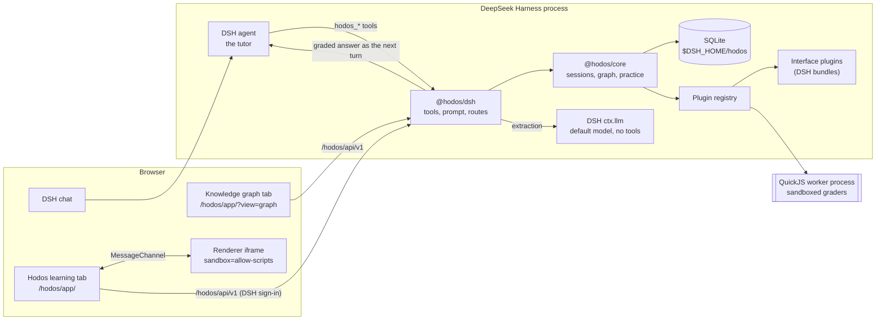

# Architecture

Hodos turns a DeepSeek Harness (DSH) chat into a learning session that follows [LearnHarness](https://github.com/amosblomqvist/learnharness)'s process: probe, plan, teach one step at a time, a knowledge graph of what was taught, and practice. The DSH agent of the chat is the tutor. Hodos owns the session state, shows and grades the questions, builds the knowledge graph, and keeps a mastery estimate per plan node. Environment plugins add question interfaces (a chess board, a Python sandbox, an expression field); none is needed to learn anything.

[ADR-0006](adr/0006-hodos-as-dsh-plugin-ecosystem.md) records why Hodos is a set of DSH plugins rather than its own server. [ADR-0007](adr/0007-learning-harness-on-dsh.md) records the move from prepared course journeys to LearnHarness's process. The [compatibility report](dsh-integration/compatibility.md) maps every DSH API Hodos uses.

## Packages

| Package | License | Role | Depends on |
|---|---|---|---|
| [`@hodos/plugin-sdk`](../packages/plugin-sdk/README.md) | MIT | Contracts, JSON Schemas, manifest validation, the renderer protocol | `ajv`, `semver` |
| [`@hodos/core`](../packages/core/README.md) | AGPL-3.0-only | Learning sessions, the knowledge graph, practice sessions, the mastery layer, the plugin registry and sandbox, the course library, storage | the SDK |
| [`@hodos/ui`](../packages/ui/README.md) | AGPL-3.0-only | The workspace (React): the session panel and the knowledge-graph view | nothing at run time (bundled; KaTeX for math) |
| [`@hodos/dsh`](../packages/dsh-adapter/README.md) | AGPL-3.0-only | The DSH bundle: service, tools, prompt, routes, the two sidebar tabs, background extraction; the `hodos` command | core, SDK; DSH packages as peers |
| [`@hodos/chess`](../packages/environments/chess/README.md), [`code`](../packages/environments/code/README.md), [`math`](../packages/environments/math/README.md), [`language`](../packages/environments/language/README.md) | MIT | Interface plugins, each also a DSH bundle, each with a course that serves as a question bank | the SDK (chess also `chess.js`; the code sandbox bundles Pyodide) |
| [`@hodos/testing`](../packages/testing/README.md) | MIT | A scripted model server and a fixture plugin | the SDK |
| [`examples/binary-numbers`](../examples/binary-numbers/README.md) | MIT | A third-party plugin in the declarative format | nothing |

The MIT packages never import the AGPL ones, so plugin authors depend only on MIT code ([LICENSING.md](../LICENSING.md)).

## Runtime picture

- **The tutor** is the DSH agent of the chat. Global tools let it start a session (`hodos_start_learning`, `hodos_start_practice`). Once the chat is a session, Hodos gives the agent the tools and prompt context of the current phase, and under the default `tutorTools: restricted` takes away every other tool except DSH's own `ask_user_question` ([security notes](security.md)).
- **Questions end the tutor's turn.** A question tool stores the question, calls `exec.concludeTurn()`, and the question appears in the Hodos tab. When the learner answers, Hodos grades it and delivers the result to the agent as the next user message (`agent.followup`, with a `hodos` message source). The chat does not wait on a blocking tool call.
- **The workspace** is one React app served by the adapter on the DSH origin, shown in two right-sidebar tabs: **Hodos learning** (the session: plan map, the open question, answered questions, practice) and **Knowledge graph**. It polls the Hodos API.
- **Renderers** draw a plugin's interface (a chess board, a code editor, a formula) inside sandboxed iframes and report the learner's response. They never grade.
- **Background extraction** calls the user's default DSH model through `ctx.llm` with no tools, under a per-learner daily budget.
- **Core** is plain TypeScript with no DSH imports. It could serve another host through the same API.

## A learning session

1. **Start.** The learner says what they want to learn. The agent calls `hodos_start_learning`; Hodos creates a session bound to the chat and switches the agent to the prober's tools and instructions.
2. **Probe.** The prober brackets, for each strand the goal depends on, something the learner reliably gets right and something they do not. Its questions are multiple choice (`hodos_probe`), an answer in the learner's own words (`hodos_recall`), or an exercise in an installed interface (`hodos_probe_exercise`). It ends with `hodos_probe_done` and an assessment per strand, which the learner sees.
3. **Plan.** The teacher writes the plan map with `hodos_plan`: a small mermaid graph from what the learner holds to the goal. Hodos parses it (a subset of mermaid: nodes, labels and arrows), checks that it is a DAG of at most 30 nodes, and shows it live. The tutor rewrites it when the learner asks for changes or teaching shows it was wrong; each rewrite is a new version.
4. **Teach.** One reasoning step at a time: a `predict` question before the step, the teaching, then a `check` question about that step only; `review` questions revisit nodes taught earlier. Every one of these is tagged with a plan node. The plan map shows the node of the latest question as current, the earlier ones as visited, the rest as upcoming. Questions:
   - `hodos_quiz`: multiple choice. The tutor commits the correct option (and an explanation) when asking; Hodos shuffles the options, adds "I don't know", grades the choice, and reveals the answer after it.
   - `hodos_explain`: an answer in the learner's own words. The tutor commits its full answer when asking. Hodos sends the learner's answer back with the commitment, and the tutor judges it; the learner sees the committed answer.
   - `hodos_exercise`: an interface from a plugin, written by the tutor (`kind`, `payload`, `key`) or asked from a question bank by reference (`bank`). The plugin validates a written item before the learner sees it, and its grader grades the answer.
   - Every form has an optional "think out loud" field, sent to the tutor with the answer.
5. **Closing.** The learner can close the session from the panel; the chat gets its tools back.

The teaching method (unconditional truths first, every step motivated, questions that measure one step) is in the tutor's prompt, written in Hodos's own words after LearnHarness's design notes.

## Questions and grading

| Form | Graded by | Can move the mastery estimate |
|---|---|---|
| Multiple choice | Hodos, deterministically, against the committed options | Yes, for `check` and `review` questions |
| Own words | The tutor, against its committed answer; Hodos records no score | No |
| Interface, `deterministic` / `engine` / `oracle` grader | The plugin's grader (in process for trusted plugins, in the QuickJS sandbox otherwise) | Yes, for `check` and `review` questions |
| Interface, `self-report` / `ai-rubric` grader | The plugin's grader, from what the browser reports or a model's judgment | No |

`predict` and `probe` answers never move the estimate, since they come before teaching. "I don't know" counts as a miss.

Stepwise interfaces (a chess line with the opponent's replies) keep their progress on the server: each move is checked, the reply comes back, and the question stays open until the line is finished or broken.

Keys stay on the server. The open question's view holds only what the plugin's schema marks visible; a written item whose question text gives away a distinctive part of its key is refused. Grader feedback that reveals more of the key than the verdict itself does is withheld. A bank item's course explanation of a detected misconception is released with the verdict. See [security notes](security.md#answer-keys).

## The mastery layer

LearnHarness keeps no mastery model; Hodos adds one on top of the same process (owner's decision in [ADR-0007](adr/0007-learning-harness-on-dsh.md)). Nothing in the session's flow depends on it.

- Each plan node has a BKT-lite estimate (`pMastered`) and an FSRS review card. Parameters are in [ADR-0005](adr/0005-bkt-lite-and-fsrs-defaults.md).
- Only `check` and `review` answers graded by a `deterministic`, `engine` or `oracle` grader update them. The guess floor of a choice question is raised to 1/options.
- A node counts as mastered at θ = 0.90, 0.95 or 0.98 by the `strictness` setting.
- The workspace lists nodes due for review across sessions; the tutor's context lists the due nodes of its session, and its instructions say to ask review questions about them.

No plugin and no tool can set an estimate: a grader returns a score, and Hodos applies it.

## The knowledge graph

After every tutor turn of a learning session, Hodos records the teacher's prose (assistant text only: not the learner's answers or thinking). Once at least 1,500 characters of new prose have accumulated, or when the learner presses **Update knowledge graph**, an extraction runs:

1. **Extractor.** A model call turns passages of teacher prose (labelled `T1`, `T2`, …) into propositions (a name and a statement, each tied to its passage) and reasoning chains (premises → conclusion).
2. **Auditor.** A second call compares the new propositions with existing ones and links duplicates.
3. **Merger.** Deterministic code is the only writer. It validates both replies, drops anything malformed or circular, merges linked duplicates, and records which source each proposition came from.

Both calls go to the user's default DSH model through `ctx.llm`, with no tools, at most 24,000 characters of source per call, and count against `backgroundCallsPerDay` (60 by default; 0 turns extraction off). One extraction runs per learner at a time.

The **Knowledge graph** tab draws propositions as nodes and chains as edges, with junction points where several premises imply one conclusion, and groups propositions by the session or notes they came from. The learner can import notes (they go through the same extractor), delete propositions (with the chains that use them), remove a whole source (keeping what it contributed, or deleting whatever only it asserted), and pick propositions to practise.

## Practice

Practice follows LearnHarness's practice sessions: a separate chat in which the tutor poses problems one at a time on picked propositions (or a free topic).

- `hodos_problem`: the tutor writes a problem, chooses its mode (`recall`, `discrimination` or `composition`), and commits its full solution before the learner sees the problem.
- The learner writes their thinking in the panel; each submission reaches the tutor as a message. The tutor answers with the smallest hint that unblocks them, on a ladder from R0 (redirect attention) to R5 (show the step).
- `hodos_conclude`: the outcome, a verdict, the highest hint rung used and the kind of miss. The committed solution appears only then.

Practice verdicts are the model's judgment, so they never move mastery estimates.

## Plugins

A plugin registers, all-or-nothing and only what its manifest declares:

- **exercise kinds**: payload, key and response schemas, a plain-text view, item validation, and guidance that goes into the tutor's tool description;
- **graders** (`deterministic`, `engine`, `oracle`, `ai-rubric` or `self-report`), each returning a score and misconception ids;
- **renderers**, with the capabilities they may use (`respond`, `resize`, and for trusted plugins `run-code`);
- **content packs** (courses), lesson blocks and pedagogy presets.

Built-in plugins are DSH bundles; their Cordis entry waits for the `hodos` service and registers through it. Declarative plugins are directories of data listed in `pluginDirs`; their graders run in the QuickJS worker. The [plugin guide](plugin-guide.md) is the authoring reference.

## Question banks

A course is a JSON document: a skill graph, lessons, and exercise items with keys, hints, explanations and misconception feedback. Approved courses are question banks. `hodos_bank` lists their items for the tutor (what the learner would see, how it was verified, never the key), and `hodos_exercise` asks one by reference. Validation checks every item against its kind's schemas and the plugin's own checks (chess.js legality, a math key equal to its formula, …).

Courses ship in plugin content packs, or arrive as **drafts** from the tutor (`hodos_propose_course`), a DSH subagent such as Claude Code (`hodos_draft_course`, outside Hodos sessions), or the course inbox (`hodos course submit`). A draft becomes a bank only after the learner approves it in the workspace, and Hodos sets the provenance of proposed items itself, so a draft cannot claim to be verified. See [course authoring](course-authoring.md).

Course lessons are validated but not shown in learning sessions: teaching is the tutor's prose.

## Storage

One SQLite database under `$DSH_HOME/hodos`, opened with `node:sqlite` in WAL mode, with versioned migrations at start and `BEGIN IMMEDIATE` transactions:

- learners, principals and DSH chat bindings, and courses (schema version 1, which also still holds the tables of the retired course journeys);
- learning sessions, questions, transcripts and plan-node states (version 2);
- knowledge-graph sources, notes, propositions, chains and model-call records, and practice sessions, problems and thinking (version 3).

Tables are learner-scoped. DSH has a single owner principal, so there is one local learner, but the schema allows more. DSH's own key-value storage is not used: it has no migrations or multi-record transactions.

## Repository layout

| Path | Contents |
|---|---|
| `packages/` | The packages above |
| `examples/` | The sample declarative plugin |
| `courses/` | Course files written with the `hodos-course` skill (see [course authoring](course-authoring.md)) |
| `tests/integration/`, `packages/*/tests/` | Unit and integration tests, run by `pnpm test` without network or keys |
| `tests/e2e/` | Browser and DeepSeek Harness end-to-end tests (`pnpm test:e2e`) |
| `scripts/` | Build, pack and clean |
| `docs/` | This documentation, the PRD, the threat model, the ADRs and the reports |
| `spikes/` | Throwaway code from the M0 spikes; not part of the build |
