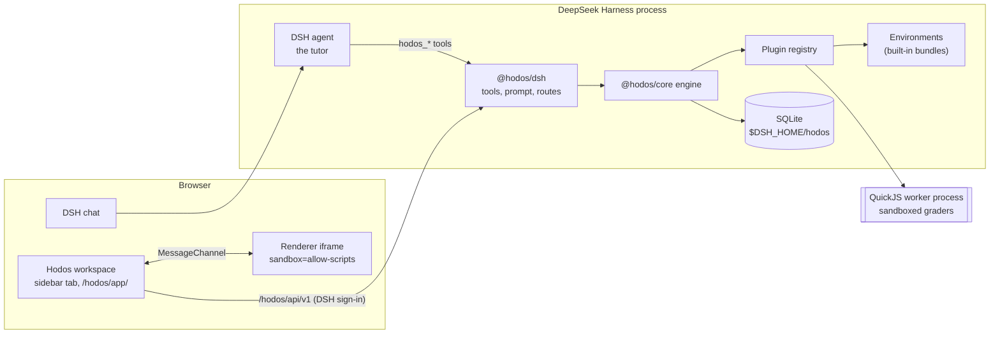

# Architecture

Hodos turns a DeepSeek Harness (DSH) chat into a tutored learning journey with mastery the platform guarantees. The DSH agent is the tutor. Hodos owns the learning state, chooses what comes next, has answers graded by environment plugins, and decides when a skill is mastered. [ADR-0006](adr/0006-hodos-as-dsh-plugin-ecosystem.md) records why Hodos is a set of DSH plugins rather than its own server; the [compatibility report](dsh-integration/compatibility.md) maps every DSH API it uses.

## Packages

| Package | License | Role | Depends on |
|---|---|---|---|
| [`@hodos/plugin-sdk`](../packages/plugin-sdk/README.md) | MIT | Contracts, JSON Schemas, manifest validation, the renderer protocol | `ajv`, `semver` |
| [`@hodos/core`](../packages/core/README.md) | AGPL-3.0-only | The engine: learning protocol, mastery, plugin registry and sandbox, content validation, storage | the SDK |
| [`@hodos/ui`](../packages/ui/README.md) | AGPL-3.0-only | The learning workspace (React) | nothing at run time (bundled) |
| [`@hodos/dsh`](../packages/dsh-adapter/README.md) | AGPL-3.0-only | The DSH bundle: service, tools, prompt, routes, sidebar tab; the `hodos` command | core, SDK; DSH packages as peers |
| [`@hodos/chess`](../packages/environments/chess/README.md), [`language`](../packages/environments/language/README.md), [`code`](../packages/environments/code/README.md), [`math`](../packages/environments/math/README.md) | MIT | Environment plugins, each also a DSH bundle | the SDK (chess also `chess.js`) |
| [`@hodos/testing`](../packages/testing/README.md) | MIT | A scripted model server and a fixture plugin | the SDK |
| [`examples/binary-numbers`](../examples/binary-numbers/README.md) | MIT | A third-party plugin in the declarative format | nothing |

The MIT packages never import the AGPL ones, so plugin authors depend only on MIT code ([LICENSING.md](../LICENSING.md)).

## Runtime picture

- **The tutor** is the DSH agent of the chat. Hodos gives it tools (`hodos_start_learning`, `hodos_next_exercise`, `hodos_hint`, …), a prompt section with the tutoring rules, and per-session learner context. Once a session is bound to a journey, it keeps only Hodos's tools ([security notes](security.md)).
- **The workspace** is a React app served by the adapter on the DSH origin and shown in a right-sidebar tab. It polls the Hodos API and renders the current mode, lesson, exercise and path. The learner answers exercises there, not in the chat.
- **Renderers** draw environment-specific views (a chess board, a code listing, a formula or graph) inside sandboxed iframes, and only display and report responses.
- **The engine** is plain TypeScript with no DSH imports. It could serve another host through the same API.

## A journey

1. The learner states a goal in the chat. The tutor calls `hodos_start_learning`. The engine picks an approved course whose environments are installed, by matching the goal against course keywords, title and skill titles (or takes the course the tutor names). It creates the journey and binds the chat session to it.
2. **Placement.** An adaptive diagnostic over the prerequisite graph places the learner. Knowing a skill implies knowing its prerequisites. Self-reports from the chat ("I know the basic rules") seed it.
3. **Planning.** The workspace shows the path of skills still to learn; the learner approves it.
4. **Per skill:** teach (a Markdoc lesson with plugin blocks and check questions) → practice (items chosen for a target success rate, with paced hints and misconception feedback) → checkpoint (fresh items, unassisted, one attempt each). Passing moves to the next skill. Failing leads to an adaptation: a weak prerequisite is put back on the path ahead of the skill, or a remedial lesson comes first; then practice and another checkpoint.
5. **Review.** Mastered skills are scheduled for spaced review (FSRS). Reviews reuse the same items and grading.

The learning protocol is an explicit state machine (`packages/core/src/protocol/journey.ts`). The tutor can explain, encourage and give hints; it cannot advance the protocol except through the same actions the learner has.

## Mastery and evidence

Every graded attempt is appended to an evidence log, with its mode, hint level and whether it was assisted. Skill state is derived from that log by an estimator chosen by the skill's learning loop, which defaults from its kind. Plugins cannot add loops or estimators.

| Learning loop (default for) | Estimator | Mastered when |
|---|---|---|
| drill (facts) | FSRS memory state per item | at least 90% of the skill's items are acquired, with checkpoint successes |
| explain-check (concepts, procedures) | BKT-lite | P(mastered) ≥ θ, with unassisted checkpoint successes on distinct items |
| recognize-fast (patterns, judgment) | Elo-style ability against item difficulty | the ability index reaches 0.5, answers are fluent, with checkpoint successes on distinct items |
| attempt-critique (performance) | Beta estimate over oracle-graded attempts | the estimate reaches the target, with at least two distinct unassisted checkpoint successes |

θ is 0.90, 0.95 or 0.98 by the `strictness` setting. [ADR-0005](adr/0005-bkt-lite-and-fsrs-defaults.md) has the parameters and the simulations behind them. Graders return evidence only. A grader that misbehaves can make an attempt count as ungraded, but it cannot mark anything mastered.

## Plugins

A plugin registers, all-or-nothing and only what its manifest declares:

- **exercise kinds**: payload, key and response schemas, a plain-text view, item validation;
- **graders**: deterministic, oracle- or engine-backed, each returning a score, skill evidence and misconception ids;
- **lesson blocks**, pedagogy presets, renderers and **content packs** (courses).

Built-in environments are DSH bundles. Their Cordis entry waits for the `hodos` service and registers through it. Declarative plugins are directories of data listed in `pluginDirs`; their graders run in the QuickJS worker. The [plugin guide](plugin-guide.md) is the authoring reference.

## Courses

A course is a JSON document: a skill graph with prerequisites, Markdoc lessons, and exercise items with keys, hints and misconception feedback. Validation checks the structure, every item against its kind's schemas and the plugin's own checks (chess.js legality, a math key equal to its formula, …), and coverage: practice, checkpoint and placement items for every skill. Courses ship in plugin content packs, or arrive as **drafts** from three places:

- the tutor (`hodos_propose_course`);
- a DSH subagent such as Claude Code (`hodos_draft_course`, outside tutoring sessions);
- the course inbox, fed by `hodos course submit`.

A draft is used only after the learner approves it in the workspace. Hodos sets the provenance of proposed items itself, so a draft cannot claim to be verified. See [course authoring](course-authoring.md).

## Storage

One SQLite database under `$DSH_HOME/hodos`, opened with `node:sqlite` in WAL mode. Versioned migrations run at start. Multi-statement changes run in `BEGIN IMMEDIATE` transactions. Tables are learner-scoped. DSH has a single owner principal, so there is one local learner, but the schema allows more. DSH's own key-value storage is not used: it has no migrations or multi-record transactions, which an append-only evidence log with derived state needs.

## Repository layout

| Path | Contents |
|---|---|
| `packages/` | The packages above |
| `examples/` | The sample declarative plugin |
| `courses/` | Course files written with the `hodos-course` skill (see [course authoring](course-authoring.md)) |
| `tests/integration/`, `packages/*/tests/` | Unit and integration tests, run by `pnpm test` without network or keys |
| `tests/e2e/` | Browser and DeepSeek Harness end-to-end tests (`pnpm test:e2e`) |
| `scripts/` | Build, pack and clean |
| `docs/` | This documentation, the PRD, the threat model and the ADRs |
| `spikes/` | Throwaway code from the M0 spikes; not part of the build |
