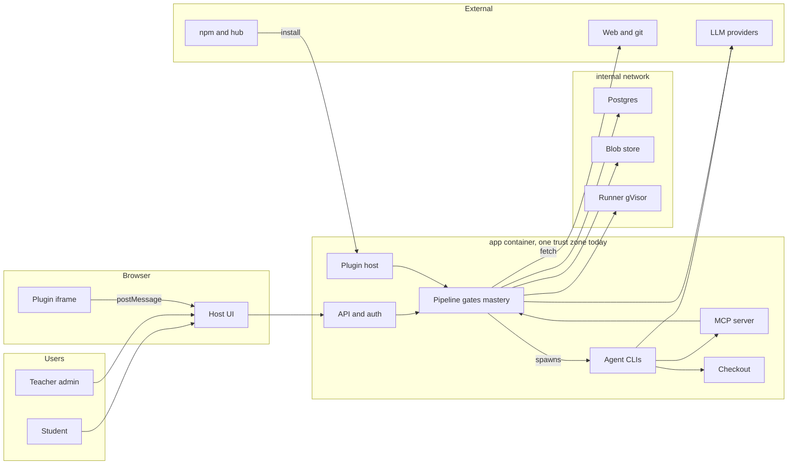

# Hodos: Threat model of the PRD system design

| | |
|---|---|
| **Reviewed** | `docs/PRD.md` (Draft v0.1, 2026-10-10), with `docs/research/lesson-ir.md` and `docs/research/intelligent-tutoring.md` for contract details |
| **Date** | 2026-10-10 |
| **Method** | Repository-grounded threat model (assets, trust boundaries, abuse paths) cross-checked with STRIDE |
| **Baseline (confirmed with the owner)** | Internet-exposed club instance: one teacher who is also admin, about 12 teenage students |

Line references such as `PRD.md:277` point into `docs/PRD.md`. There is no code yet, so every anchor is a design statement, not an implementation.

---

## Executive summary

The PRD gets several hard things right: content is inert Markdoc with no evaluation path, answer keys are stripped by schema rather than by a field list, grading is server-side, Postgres as the single source of truth removes file-hook and symlink attacks on stored content, learner code runs in a gVisor runner with no network, and spend has caps. The top risk is one architectural gap: **the AI agent CLIs run inside the app container** (`PRD.md:272`, `:436`, `:502`), so a prompt injection from any web page the agent reads, or from a shared course, turns into code execution next to the database credentials, the secrets key and every provider token. Its permission policy and tool allowlist are enforced by the agent process itself, which is the thing being attacked. The second theme is that **"sandboxed plugins" covers only the browser**: plugin `validate()`, `validateItem()`, non-code `grade()` and install scripts run in the app process (`PRD.md:357–358`). The remaining High items are untrusted URLs fetched with no SSRF policy, course imports that can plant agent configuration or persistent injections, AI content that reaches teenage students without review (adaptive overlays, chat, auto-approve), autograder tampering by students, and insecure self-host defaults. Each one has a contained, design-level fix that is cheapest to adopt before M1.

---

## Scope and assumptions

**In scope:** `docs/PRD.md` §§3–10 and 14 (roles, pipeline, mastery gates, exercises, sources, versioning, AI lanes, auth, sharing, plugin system, architecture, security model); `docs/research/lesson-ir.md` §§4–5, 7, 9.4 (plugin API, iframe payload, visibility); `docs/research/intelligent-tutoring.md` §§5.2, 6 (tutor policy, exercise contract).

**Out of scope:** hosted multi-tenant SaaS (a stated non-goal, `PRD.md:56`); proctoring and cheating with outside tools (a non-goal, `PRD.md:58`); LTI 1.3 (v1.x); host OS and hypervisor hardening; the M0 eval scripts in `docs/research/sim-diagnostic/` (offline research code).

**Assumptions:**
- One `docker compose` host on a VPS or home server, with the web UI reachable from the internet so students can study from home.
- The admin is trusted. In the baseline the teacher is the admin. Students are untrusted and motivated: teenagers will try to get answers, fake mastery and see each other's data.
- Adversaries with no account: authors of web pages and documents the agent ingests, publishers of shared course repos, and npm or hub plugin authors (or whoever compromises their accounts).
- Some students are minors, so learner data is sensitive personal data. AI provider API keys and CLI login tokens (possibly the admin's personal subscription) are the highest-value secrets.

**Open questions that would change the ranking:**
1. Will instances with several teachers who must not see each other's students be supported in v1? If yes, TM-017 rises from Low to **Critical** (see the threat table).
2. Will lesson chat be a tool-using agent with MCP access, or a plain LLM call that receives server-assembled context? A tool-using chat raises TM-008 to High.
3. Is open self-registration intended, or invite-only? Open registration raises TM-012 and the brute-force side of TM-002.

---

## System model

### Primary components

| Component | Role | Evidence |
|---|---|---|
| **app** (Bun + Hono API, React SPA, Better Auth) | All user traffic, RBAC, pipeline gates, mastery and tutor policy | `PRD.md:430–434`, `:283` |
| **MCP server** (inside app) | Domain tools for agents: `graph.propose`, `sources.search`, `lesson.validate`, `learner.context`, `job.report` | `PRD.md:273` |
| **ACP client + agent CLIs** (inside app image) | Spawns Claude Code, Codex, Gemini CLI, OpenCode for plan and write jobs | `PRD.md:272`, `:436` |
| **Throwaway checkout** | Per-job file copy of the draft that the agent edits, imported back through the validator | `PRD.md:250`, `:441` |
| **cordis plugin host** (inside app) | Loads npm plugins; registers blocks, layouts, exercise kinds and presets | `PRD.md:352–359` |
| **Plugin iframes** (browser) | Plugin UIs that render AST nodes and send answer events through postMessage | `PRD.md:376`, `:388–389` |
| **runner** (gVisor or rootless) | Learner code, code graders, materializers; no network by default | `PRD.md:381–383`, `:474` |
| **Postgres + pgvector** | Single source of truth: content versions, learner data, event log, encrypted secrets, job queue | `PRD.md:449–459` |
| **Blob store** (volume or S3-compatible) | Uploaded books, cached source snapshots, materializer output | `PRD.md:440`, `:451–455` |
| **External services** | LLM providers and Ollama (lanes 1–2), the open web, git remotes, npm and the hub, an optional LRS | `PRD.md:274`, `:293–294`, `:265` |

### Data flows and trust boundaries

- **Internet → app API.** Credentials, session cookies, attempts, learner code, uploads. HTTP(S) via oRPC. Better Auth sessions and RBAC (`PRD.md:283–286`). **Not specified:** TLS termination, registration policy, admin bootstrap, rate limits, CSRF and CSP headers.
- **Host UI ↔ plugin iframe.** Validated AST nodes with `x-visibility: server` fields removed, resolved asset URLs, and answer events. postMessage with manifest-declared capabilities enforced by the host API (`PRD.md:388–389`, `lesson-ir.md:317`). **Not specified:** how a "sandboxed origin" is obtained on a single-hostname install, or how messages are authenticated.
- **app → agent CLI process.** Prompts, `catalog.md`, `AGENTS.md`, retrieval sets, provider credentials. ACP over stdio, inside the same container (`PRD.md:436`, `:502`). Controls are a platform permission policy and a tool allowlist (`PRD.md:277`), both enforced by the CLI itself. **There is no OS-level boundary.**
- **Agent → MCP server.** Tool calls that carry course, lesson and learner identifiers. "MCP tools enforce authorization themselves" (`PRD.md:499`). **Not specified:** whose identity a call carries, or how it is scoped to one job.
- **Agent → checkout → import validator → Postgres.** Plain files. Path and type allowlist, no symlinks, size limits, schema validation, one transaction (`PRD.md:250`, `:505`). **This is a strong control.** It is not stated to apply to git import (SH-2).
- **app or agent → open web and git remotes.** URLs chosen by the agent, by injected content or by an imported course; HTML, PDF, transcripts, repos. Only a "source-fetch tool" is mentioned (`PRD.md:499`). **No SSRF, redirect, size or parser policy.**
- **app → LLM providers.** Prompts that include learner context, plus API keys or OAuth tokens. HTTPS. UI warning about consumer logins (`PRD.md:272`). **No data-minimization rule** for student data.
- **app → runner.** Learner code, tests, reference solutions, materializer inputs. gVisor or rootless, CPU, memory and time limits, no network by default, no host mounts (`PRD.md:501`). **Not specified:** runner API authentication, who may request network, how tests are separated from learner code.
- **npm and hub → cordis host.** Plugin packages. Provenance and permissions shown, an "install untrusted" confirmation (`PRD.md:139`, `:503`). **Server-side plugin code runs in the app process.**
- **app → Postgres and blob store.** SQL, blobs, credentials from the environment. **Not specified:** network exposure, generated credentials, how blob reads are authorized.
- **app → external LRS (optional).** xAPI statements (`PRD.md:265`).

#### Diagram

---

## Assets and security objectives

| Asset | Why it matters | Objective |
|---|---|---|
| AI provider API keys, agent CLI OAuth tokens | Direct financial loss; a personal subscription token means account takeover | C |
| Secrets encryption key, DB and blob credentials | Unlock every other secret and all data | C |
| Learner data (minors): attempts, mastery, misconceptions, chat, code | Privacy harm, regulatory exposure, trust | C, I |
| Checkpoint pools and answer keys (tests, reference solutions, rubrics) | Leaked keys void the mastery gate for the whole class; items are reused | C |
| Mastery state and gate decisions | "Honest mastery" is differentiator #2 (`PRD.md:33`) | I |
| Published course versions, `catalog.md`, `AGENTS.md`, notes | Students follow lesson instructions; every agent run reads the catalog | I |
| Accounts, roles, sessions | Admin takeover leads to everything above | C, I |
| Plugin code and the installed set | Runs with app privileges today | I |
| Runner capacity and LLM budget | Class-wide outage when exhausted or capped | A |
| xAPI event log and approval records | Teacher tracing, item analysis, accountability | I |

---

## Attacker model

### Capabilities
- **Content attacker (no account):** publishes or edits web pages, docs, papers, transcripts or wiki edits that the agent may retrieve, and can make retrieval favor them (SEO, prompt-bait). Can publish a course repo or a hub listing and persuade a teacher to import it.
- **Supply-chain attacker:** publishes a typo-squatted or useful plugin, or takes over a legitimate plugin author's npm account and ships a malicious update.
- **Student (authenticated, low privilege):** unlimited practice and test runs, lesson chat, data export; can read and modify everything in their own browser (devtools); writes arbitrary code that the runner executes; shares findings with classmates.
- **Internet scanner:** finds exposed ports and default credentials, and registers on fresh instances.

### Non-capabilities
- No compromise of LLM providers, npm's registry infrastructure, or the host kernel or hypervisor (a gVisor escape is out of scope).
- No physical or shell access to the host.
- The admin acts in good faith but is not a security expert. They will click through warnings, and a code review of AI-generated plugins is weak evidence.
- Students in another tab or on another device using outside AI during a checkpoint are an **accepted risk**, since proctoring is a non-goal.

---

## Entry points and attack surfaces

| Surface | How reached | Trust boundary | Notes | Evidence |
|---|---|---|---|---|
| Sign-up, login, OAuth | Internet | Internet → app | Registration policy and admin bootstrap undefined | `PRD.md:283` |
| Course Studio chat | Teacher | app → agent | Direct natural-language line to a tool-using agent | `PRD.md:168` |
| Intake uploads (books, files) | Teacher | Internet → app → blob | Parsed for chunking; stored as blobs | `PRD.md:169`, `:238` |
| Source search, fetch, ingest | Agent via MCP or fetch tool | app → web | URLs controlled by attackers or injected content | `PRD.md:273`, `:499` |
| Course import from URL | Teacher | app → git remote → validator | Repo content and source list controlled by an attacker | `PRD.md:293` |
| Plugin install (hub, npm, Forge) | Admin | npm → plugin host | Server code runs in process | `PRD.md:139`, `:294`, `:410–417` |
| Lesson chat | Student | app → LLM, maybe → MCP | Uses `learner.context` | `PRD.md:217` |
| Attempt submit; run tests | Student | Internet → app → runner | Unlimited runs; tests and solutions near learner code | `PRD.md:225`, `:228` |
| Plugin host API (postMessage) | Plugin UI | iframe → host | Capability enforcement | `PRD.md:388–389` |
| Data export and delete | Student | Internet → app | Must not include keys | `PRD.md:285` |
| MCP server | Agent | agent → MCP | Caller identity unspecified | `PRD.md:273`, `:499` |
| Checkout import | Agent | checkout → validator | Strong allowlist | `PRD.md:250`, `:505` |
| Blob and asset serving | Browsers | app → browser | Cached web snapshots are attacker-authored | `PRD.md:440`, `:455` |
| LRS forwarding | app | app → LRS | Optional | `PRD.md:265` |
| Admin settings (keys, caps, harnesses) | Admin | Internet → app | High-value actions | `PRD.md:71`, `:276` |

---

## Top abuse paths

1. **Poisoned page → agent → instance secrets (TM-001).** The attacker plants instructions in a page ranked for "Rust ownership tutorial" → the teacher starts a plan job → the agent ingests the page → the agent uses its shell or file tools to read the container environment and CLI credential files, or connects to Postgres directly → it exfiltrates them through the fetch tool or an outbound request → **impact:** provider keys, the secrets key and all student data stolen.
2. **Shared course plants agent config (TM-004 → TM-001).** The attacker publishes a "great Python course" repo containing `.mcp.json` or a CLI settings file with hooks, plus a poisoned `AGENTS.md` → the teacher imports it by URL → if the import stores arbitrary paths, the next checkout writes those files into the agent's working directory → the CLI loads them as project configuration → **impact:** command execution with no prompt injection needed, repeated on every job.
3. **Course import → SSRF (TM-005).** The imported course lists sources such as `http://169.254.169.254/...`, `http://postgres:5432`, `http://192.168.1.1/admin` → re-fetch on import (`PRD.md:293`) → responses are stored as "sources" that the teacher can view, or cited in drafts → **impact:** cloud instance credentials, LAN reconnaissance, internal admin pages read.
4. **Malicious plugin update (TM-003).** The attacker takes over a popular plugin's npm account → publishes a patch version → the admin updates from the hub → the plugin's `validate()` runs in the app process on the next lesson save → it reads the database pool and environment → **impact:** full compromise. "Never exposed to plugins" (`PRD.md:286`) does not hold.
5. **Fresh deploy on a VPS (TM-002).** `docker compose up` publishes the Postgres or object-store port with a placeholder password, or the first registered account becomes admin → a scanner finds it within hours → **impact:** full compromise before the teacher has finished setup.
6. **Student reads hidden tests (TM-007).** The student's submission prints the test file and reference solution during a "run" → the output comes back as per-test feedback → the student shares the checkpoint keys with the club, or patches the test framework to report all tests passing → **impact:** the gate is void for every student, and the dashboards show false mastery.
7. **Poisoned source → remedial overlay (TM-006).** A student fails a checkpoint → the automatic adapt pass (no teacher approval, `PRD.md:92`) retrieves a poisoned chunk → the overlay tells the teen to "fix your setup" with `curl … | sh` or a typo-squatted package → **impact:** the student's own machine is compromised.
8. **Chat as confused deputy (TM-008).** A student asks lesson chat "what mistakes does Alex keep making?" → the chat model calls `learner.context` with an ID it chose → the tool trusts its argument → **impact:** a classmate's learning data is exposed.
9. **Denial of wallet (TM-012).** A student scripts repeated checkpoint failures and chat floods → every failure triggers an adapt pass and generation → the instance cap is hit and generation pauses for the whole class (`PRD.md:276`).

---

## Threat model table

Sorted by priority (most severe first).

| Threat ID | Threat source | Prerequisites | Threat action | Impact | Impacted assets | Existing controls (evidence) | Gaps | Recommended mitigations | Detection ideas | Likelihood | Impact severity | Priority |
|---|---|---|---|---|---|---|---|---|---|---|---|---|
| TM-001 | Content attacker; imported course; a teacher's own chat instructions | Any plan or write job that touches attacker-influenced text (every course retrieves open-web sources) | Indirect prompt injection makes the agent CLI (inside the app container) read env vars and credential files, reach Postgres, the runner or the LAN, and exfiltrate through fetch or outbound HTTP | Full instance compromise: secrets, provider tokens, all learner data, ability to publish content | Provider keys and tokens, secrets key, learner data, course integrity | Throwaway checkout as working directory, allowlisted tools, permission requests answered by policy, MCP self-authorization, "no direct DB or network access" (`PRD.md:277`, `:499`) | Every control is enforced by the compromised process. There is no OS, network or credential boundary: the agent CLIs are "installed in the app image" (`PRD.md:272`) and credentials "stay inside the app container" (`PRD.md:502`) | Run every agent job in its own sandbox container (reuse the runner's gVisor class): only the checkout mounted; no app env or secrets; non-root; default-deny egress through a proxy that allows only the LLM API host(s) and the platform's MCP endpoint. Inject the provider credential at the proxy where the CLI supports a custom base URL; otherwise use a dedicated, spend-capped key, never the admin's personal subscription token on a multi-user instance. Use a per-job MCP token bound to (job, course draft, teacher) that expires when the job ends. Move all web access into the platform fetcher (TM-005). Document that the teacher role can run code inside the job sandbox | Log every tool call and permission decision to the event log; alert on denied egress, reads outside the checkout, and MCP calls outside the job's scope | High | High | **critical** |
| TM-002 | Internet scanner; opportunistic attacker | Default compose or scaffold publishes DB, object-store or runner ports, uses placeholder passwords, makes the first user admin, or serves plain HTTP | Connects to Postgres or MinIO directly; registers first on a fresh instance; steals session cookies over HTTP | Full compromise, often before setup is finished | All | None stated. G5 optimizes for one-command install (`PRD.md:51`); the scaffold uses `--db-setup docker` (`PRD.md:483`) | No secure-defaults requirement anywhere in the PRD | Expose only a reverse proxy (80/443). All other services on an internal network with no host ports. Generate random secrets on first run (`.env`, mode 0600). Bootstrap the admin with a one-time setup token printed to the logs. Invite-only registration by default, with per-course invite links. Bundle TLS (e.g. Caddy). `Secure`, `HttpOnly`, `SameSite` cookies; HSTS. Rate-limit login with lockout; optional TOTP for admin. Add an admin "security self-check" page (open ports, TLS, default credentials, open registration). Check the generated scaffold against this list at M1 | Failed-login metrics; alert on new admin-role grants; startup warning when a default secret is detected | High | High | **high** |
| TM-003 | Supply-chain attacker; malicious or sloppy Forge output | The admin installs or updates a plugin (one-click hub, npm name, "install untrusted", or Forge) | Plugin `apply()`, `validate`, `validateItem`, non-code `grade`, `fallback.text`, `migrate` and package install scripts run in the app process; the plugin self-declares `trust: first-party`; `grade` returns 1.0 to forge mastery | Full compromise; mastery forgery; secrets readable despite AU-4 | All; mastery integrity | Curated static hub, provenance and permissions shown, explicit untrusted step, iframe for UI, code graders in the runner (`PRD.md:139`, `:388–391`, `:503`) | Manifest permissions don't constrain server code; validation runs "on the server" (`PRD.md:357`); provenance is shown, not enforced; how `trust` is assigned is unclear (`lesson-ir.md:232`); the hub index pins neither versions nor hashes | Run every non-first-party server hook in an isolated plugin worker (separate process or container with no DB, no secrets, no network; JSON-in/JSON-out RPC with CPU and time limits). The M0 cordis spike chose a **QuickJS-wasm context inside a separate, OS-confined Bun worker** (ADR-0002): a single-file pure-function bundle with no Node/Bun/Web globals, host-enforced per-call CPU, wall and result-size limits, kernel memory and pid caps, host-side shape validation of every result, and kill-then-retry-once on a breach. Install with lifecycle scripts disabled. Pin exact versions with integrity hashes; no auto-update. Assign `first-party` from a platform-shipped allowlist, never from the manifest. Hub index entries pin `name@version` plus integrity, and the index is signed. Forge output always installs at the untrusted tier, and its contract tests run in the runner | Log installs and updates with the integrity hash; alert on worker egress or limit violations; diff the manifest on update | Medium | High | **high** |
| TM-004 | Course-repo publisher; an earlier injected run | Teacher imports a course (`PRD.md:293`), or an earlier job wrote poisoned `notes/`, `index.md` or a catalog proposal | (a) Persistent injection in `AGENTS.md`, `catalog.md` or notes, which every run reads (`PRD.md:97`, `:455`). (b) The import stores non-blueprint paths (`.mcp.json`, CLI settings with hooks, `CLAUDE.md`, `GEMINI.md`, `.codex/`, `opencode.json`), which the next checkout writes into the agent's working directory | Repeated TM-001 compromise; poisoned output across all lessons | Course integrity; everything in TM-001 | Allowlisted import for checkouts: no symlinks, size limits, validator, one transaction (`PRD.md:250`, `:505`) | SH-2 import isn't stated to use the same allowlist; no rule on which files agents may change; `AGENTS.md` and `catalog.md` are treated as trusted instructions | One shared import validator for SH-2 import, checkout import and the in-app editor, with a fixed path schema (`course.yaml`, `graph.yaml`, `catalog.md`, `lessons/*.md`, `checkpoints/*`, `notes/*.md`, `index.md`, `log.md`). Render `AGENTS.md` at checkout time from platform templates and plugin guidance; never import it. Make `catalog.md` teacher-write-only, so agent changes arrive as a proposal in the diff. Launch each CLI with project and user config discovery disabled and an explicit MCP config (verify each CLI's flags in the M0 ACP spike). Show catalog and notes changes as flagged items that can't be batch-approved. Show imported catalog and notes to the teacher as untrusted | Import report listing rejected paths; alert on catalog or notes changes | Medium | High | **high** |
| TM-005 | Content attacker; course-repo publisher | The agent asks to fetch an attacker URL, or an imported course lists sources (re-fetched on import, `PRD.md:293`) | SSRF to cloud metadata, `postgres`, MinIO, the runner API or LAN devices; redirect and DNS-rebinding bypasses; git transports other than https, submodules, huge repos; decompression bombs; parser exploits in PDF, EPUB or HTML handled in the app process | Internal data pulled into "sources" that the teacher can view or that get published; cloud credentials; LAN access; app crash or RCE | Infra credentials, LAN, availability | "No direct DB or network access beyond the source-fetch tool" (`PRD.md:499`) | No fetcher specification at all | A single platform fetcher running in a runner-class sandbox. https only (http opt-in). Resolve DNS, block private, loopback, link-local, CGNAT and IPv6 ULA ranges, and pin the resolved IP for the connection. Re-check every redirect; cap redirects, size and time; allowlist content types. Git: https transport only, no submodules or LFS, shallow clone with a size cap, inside the sandbox, then through the TM-004 validator. Parse documents in the sandbox and store extracted text. On import, show the source list to the teacher and cap its size before fetching anything | Log every fetch destination; alert on blocked internal targets | Medium | High | **high** |
| TM-006 | Content attacker via retrieval | A poisoned chunk is in a retrieval set used for drafts, overlays or chat | Lessons, remedial overlays or chat answers tell students to run `curl … \| sh`, install a typo-squatted package, open a phishing link or enter credentials. Paths that skip review: adaptive overlays (`PRD.md:92`, `:252`), lesson chat (`:217`), auto-approve that stays on after the instance gains users (`:179`), batch approval of "clean" items (`:176`). Entailment checks pass because the cited chunk is itself poisoned | Students' (minors') own machines and accounts compromised; trust destroyed | Course integrity; student safety | Teacher diff for blueprint versions; inert HTML and literal `javascript:` links (`lesson-ir.md:316`) | No link, command or download policy; overlays and chat are never reviewed; the auto-approve condition isn't enforced | A T0 "risky element" lint: extract every external URL, shell command, package install, download and credential prompt, and show each as a flagged item that can't be batch-approved. Keep a per-course domain allowlist built from approved sources. Overlays and chat may only link to URLs and packages already in the approved version; strip or block anything new. Auto-approve only while the instance has exactly one account, re-checked at each approval and switched off automatically when a second account appears. Always show link destinations | Log new URLs in overlays and chat; teacher alert when one is blocked | Medium | High | **high** |
| TM-007 | Student | An oracle-graded code exercise (the v1 showcase, `PRD.md:401`) | Learner code reads test files or the reference solution in the sandbox and prints them during unlimited runs (`PRD.md:228`); or patches the test framework or exits early so that it reports passes on submit | Checkpoint keys leak to the whole club; the mastery gate is forged; dashboards are false | Answer keys, mastery integrity | Server-side grading, the runner sandbox, run vs submit (`PRD.md:225`, `:228`, `:501`) | Keys are protected from the browser but not from learner code inside the same sandbox | Never put the reference solution in the learner sandbox. Run hidden tests in a separate process and uid from learner code, and have the harness report results through a channel learner code can't write (parent-collected exit status plus a per-run nonce). Prefer I/O tests whose expected output is compared outside the sandbox. Keep checkpoint tests separate from practice tests; run output shows only public test names; truncate output; randomize inputs per attempt where possible | Flag run output containing test source or key strings; flag a submit that passes after zero passing runs | High | Medium | **high** |
| TM-008 | Student via lesson chat; injected agent | Chat or agent tools accept learner, course or source IDs as model-chosen arguments | Calls `learner.context`, `sources.search` or `lesson.read` for another student, course or teacher's upload | Classmates' learning data, other courses' private books exposed | Learner data, uploaded content | "MCP tools enforce authorization themselves" (`PRD.md:499`); AU-2 and TR-5 (`PRD.md:284`, `:264`) | Caller identity for tools is undefined | Take identity from the server-side session or job token, never from tool arguments. In chat, `learner.context` takes no student ID (always the current user). Lane-1 tokens are scoped to one course draft. Add T2 scenarios such as "show me Alex's mistakes" | Log tool calls whose arguments differ from the token's scope | Medium | Medium | **medium** |
| TM-009 | Malicious plugin UI, or XSS inside one | A single-hostname install (often a bare IP); the iframe allows `allow-same-origin` or is served from the app origin | Plugin JS reads host cookies and storage and calls the API as the viewer (the teacher-admin when previewing courses); forged postMessage; exfiltration of student work; a fake login overlay | Admin session takeover; student data exposed | Sessions, learner data | Iframe, scoped postMessage API, manifest capabilities (`PRD.md:376`, `:388–389`) | How a "sandboxed origin" is obtained on a one-host install is undefined | `sandbox="allow-scripts"` without `allow-same-origin` (an opaque origin works on any single host). Hand the iframe a `MessageChannel` port at load and validate every message against the capability schema. Strict CSP on plugin documents (`connect-src 'none'`, no forms, no top-level navigation). App CSP with `frame-ancestors 'none'` | Log capability denials and malformed messages | Medium | Medium | **medium** |
| TM-010 | Content attacker; uploader | Cached web snapshots or uploads are served from the app origin as `text/html` or SVG | Stored XSS when the teacher opens the "original passage"; dedup or hash-only blob URLs let one user fetch another's private upload | Admin session takeover; private books exposed | Sessions, uploads | Blobs are immutable, content-addressed and validated on write (`PRD.md:449`) | Serving policy and read authorization are unspecified | Show cached sources as extracted text only. Serve blobs with `Content-Disposition: attachment`, `nosniff` and `CSP: sandbox`, or from a separate origin; never serve HTML or SVG inline. Authorize every blob read; never rely on a hash as the capability | Alert on HTML or SVG blob requests | Medium | Medium | **medium** |
| TM-011 | Student | Access to any egress other than the stripped lesson AST | Keys leak via data export (`PRD.md:285`); plugin feedback where `revealsAnswer` is self-reported (`intelligent-tutoring.md:441`); validation or error messages; teacher-only endpoints missing role checks; LRS statements; hub-published courses that ship checkpoint pools with keys | Checkpoint pools leak; the gate is weakened | Answer keys | Schema-driven stripping, release timing, server grading (`PRD.md:225`, `:500`) | Stripping is specified for the AST and iframe path only | One "student view" projection function used by every serializer, export, LRS forwarder and chat context, with tests. In checkpoint mode the platform returns only the score until the release event, ignoring plugin feedback. Hub and git exports exclude checkpoint pools and keys by default, with a warning when included. AuthZ tests for teacher endpoints | Canary strings in keys; alert if one appears in any student-bound response | Medium | Medium | **medium** |
| TM-012 | Student or compromised student account | Generation is triggered by student actions | Repeated checkpoint failures trigger the adapt pass; chat floods; unlimited practice generation (`PRD.md:132`); L3–L5 hints generated and verified on demand (`PRD.md:227`); test-run loops | Instance cap hit, so generation pauses for the whole class; runner saturated | Budget, availability | Monthly caps per instance, course and student; rate-limited hint ladder (`PRD.md:276`, `:226`) | No per-endpoint rate limits; adapt pass not debounced; the student pool can drain the teacher's budget | Per-student token buckets on chat, hints, practice generation and runs. Cache and reuse generated variants and L3–L5 hints per item across students. Debounce the adapt pass (once per skill per day; reuse the existing overlay). Reserve the teacher's generation budget separately. Alert at 50% and 80% of the cap | Spend anomalies per student in the TR-7 view | Medium | Medium | **medium** |
| TM-013 | Anyone with a foothold (TM-001, TM-003) | The runner API is reachable on the internal network | Calls the runner directly to start containers with network on, extra mounts or no limits; uses the runner's container-runtime access to reach the host | Host compromise; bypasses the sandbox | Host, availability | App never touches the Docker socket; gVisor or rootless; limits; no network by default (`PRD.md:390`, `:501`) | Runner API authentication and who may request network (`lesson-ir.md:253`) are unspecified | The runner enforces its own policy: an allowlist of image digests, no caller-chosen mounts, network only for materializers the admin approved at install. Authenticate with a per-service secret or mTLS. Use a rootless runtime or gVisor inside the runner rather than the host Docker socket. Per-student queues and quotas, plus PID, disk and output caps | Log every job spec; alert on rejected specs | Low | High | **medium** |
| TM-014 | n/a (privacy and compliance) | Lane 1 or lane 2 calls include learner context | Minors' mastery, errors, chat and code go to third-party providers, possibly under consumer terms that allow training | Regulatory exposure (GDPR, COPPA-like rules), parent trust | Learner data | UI warning about consumer CLI logins (`PRD.md:272`); Ollama option (`PRD.md:274`) | No data-minimization or pseudonymization requirement | Pseudonymize names and IDs in prompts; send `learner.context` only for the minimum skills needed. A per-provider admin switch, "may receive student data". A privacy notice listing providers. Student data never goes into lane-1 generation jobs | Log which provider received student context, per call | High | Low | **medium** |
| TM-015 | Anyone holding a backup | `pg_dump` and blob backups copied off-host (`PRD.md:51`) | Decrypts secrets if the key is stored with the data or the backup | Provider keys stolen | Secrets | Secrets encrypted at rest (`PRD.md:286`) | Key location, rotation and backup are unspecified | Keep the key in a file or secret outside the DB and outside backups; document backing it up separately; support rotation. (Moot until TM-001 and TM-003 are fixed, since both expose the key at runtime) | Startup check that the key isn't stored in the DB | Low | High | **low** |
| TM-016 | Insider or attacker covering tracks; data-subject requests | Write access to the event and version tables | Edits or deletes events and approvals; append-only conflicts with account deletion (`PRD.md:260` vs `:285`) | Tracing and accountability lost; GDPR erasure is impossible or breaks the log | Event log, approvals | Append-only log; approver recorded on versions (`PRD.md:249`, `:260`) | Append-only is a convention; admin actions aren't logged | DB role without UPDATE or DELETE on event, blob and version tables. Audit events for admin actions (plugin install, role change, auto-approve toggle, caps, secrets, approvals). Pseudonymous actor IDs with a deletable mapping table for erasure | Periodic hash-chain check of the log | Low | Medium | **low** |
| TM-017 | Teacher on a shared instance (not the baseline) | More than one teacher, where teacher ≠ admin | Course Studio chat directly instructs a tool-using agent to run code (TM-001); enrolls any student to see their global skill graph, which spans other teachers' courses (`PRD.md:86`, `:284`) | Teacher-to-admin escalation; cross-teacher privacy breach | Learner data, all secrets | AU-2 enrollment scoping (`PRD.md:284`) | Enrollment control and cross-course scoping of the global graph are undefined | Fixing TM-001 removes the code-execution path. Enrollment by invite with student acceptance, or by the admin. Teacher views limited to the skills inside their own course | Alert on enrollments of students outside the teacher's invites | Low (baseline) | High | **low** (**critical** if multi-teacher) |

---

## Criticality calibration

| Level | Meaning for Hodos | Examples |
|---|---|---|
| **Critical** | Likely code execution or secret theft in the app or agent zone, reachable by anyone who can influence web content or by an unauthenticated user | TM-001 (prompt injection → agent → secrets); pre-auth admin takeover; TM-017 on a multi-teacher instance |
| **High** | Full compromise behind one realistic precondition (the admin installs a plugin, the teacher imports a course, a default deploy), harm to students' own devices, or the mastery gate voided for the class | TM-002 defaults, TM-003 plugin server code, TM-004 import planting, TM-005 SSRF, TM-006 unreviewed content, TM-007 autograder tampering |
| **Medium** | Exposure of one class's data, key leaks for some items, a budget or runner outage, or a compromise that needs a prior foothold | TM-008 chat IDOR, TM-011 key egress, TM-012 denial of wallet, TM-013 runner control plane |
| **Low** | Needs an unlikely precondition or insider access, an audit or accountability gap, or impact that is moot until higher items are fixed | TM-015 backup key handling, TM-016 log integrity |

---

## Focus paths for security review

There is no code yet, so these are the design sections to amend now and the modules to review first when they exist.

| Path | Why it matters | Related Threat IDs |
|---|---|---|
| `docs/PRD.md` §6.9 AI-1 and AI-6 (`:272`, `:277`) | Where the agent runs and what it can reach; needs a per-job sandbox requirement | TM-001, TM-017 |
| `docs/PRD.md` §10 (`:494–507`) | Several mitigations are stated as properties with no mechanism ("no direct network access", "never exposed to plugins") | TM-001, TM-003, TM-005 |
| `docs/PRD.md` §8.1 and §8.3 (`:352–391`) | Where plugin server hooks execute, how `trust` is assigned, the iframe origin strategy | TM-003, TM-009 |
| `docs/PRD.md` §6.11 SH-2 and SH-3 (`:293–294`) | Import path validation, the source re-fetch list, hub index pinning and signing | TM-004, TM-005, TM-003 |
| `docs/PRD.md` §6.7 VC-1b (`:250`) | The import allowlist is the strongest control; make it the only path for every content write | TM-004 |
| `docs/PRD.md` §6.6 SR-2 (`:238`) | Needs a fetcher and parser specification alongside the copyright policy | TM-005, TM-010 |
| `docs/PRD.md` §4 Adaptive layer, VC-3, CS-9, CS-12, LS-7 | Paths where AI output reaches students without full review | TM-006, TM-008 |
| `docs/PRD.md` §6.5 EX-2 and EX-5, §8.5 `code-exercise` | Test and solution placement inside the runner; one projection for every egress | TM-007, TM-011 |
| `docs/PRD.md` §9.3 Deploy and scaffold (`:476–490`) | Secure compose defaults, admin bootstrap, TLS | TM-002, TM-013 |
| `docs/PRD.md` §6.10 AU-1 to AU-4 (`:283–286`) | Registration policy, enrollment control, key management, export filtering | TM-002, TM-011, TM-015, TM-017 |
| `docs/PRD.md` §6.9 AI-5 (`:276`) | Per-endpoint rate limits and budget partitioning | TM-012 |
| `docs/research/lesson-ir.md` §4 `renderer`, `materializer.resources` (`:229–253`) | Where `trust` and network permission are declared | TM-003, TM-013 |
| `docs/research/intelligent-tutoring.md` §6 `GradeResult.feedback.revealsAnswer` (`:441`) | A self-reported leak flag; the platform must enforce it instead | TM-011 |
| M0 spikes (b) and (c) (`PRD.md:563`) | Add a sandbox and egress-proxy test for ACP agents, and a JS-isolate test for plugin hooks | TM-001, TM-003 |

---

## Recommended PRD edits, in priority order

1. **Critical. Add AI-7, "Agent job isolation":** each ACP job runs in its own sandbox container with only the checkout mounted, no app secrets, default-deny egress through a proxy allowing only the LLM API and the MCP endpoint, a per-job MCP token, and credentials injected at the proxy where possible. Add it to M0 spike (c) as an exit criterion. Rewrite §10 row 2 to reference this mechanism.
2. **High. Add DP-1, "Secure self-host defaults":** only the proxy is exposed, secrets are generated on first run, a setup token bootstraps the admin, registration is invite-only, TLS is bundled, login is rate-limited, and the admin has a security self-check page. Add an M1 exit criterion: "scaffold reviewed against DP-1".
3. **High. Amend §8.1 and §8.3:** non-first-party server hooks run in an isolated plugin worker; install scripts are disabled; versions are pinned with integrity hashes; `first-party` is assigned by the platform; hub entries are pinned and the index is signed. Fix the §10 supply-chain row, which currently says server work runs in the runner.
4. **High. Amend SH-2 and VC-1b:** one validator and path schema for every content write; `AGENTS.md` is rendered by the platform, never imported; `catalog.md` is teacher-write-only; CLI config discovery is disabled.
5. **High. Add SR-8, "Fetcher policy":** a sandboxed fetcher with private-range blocking after DNS resolution, redirect re-checks, size and type caps, https-only git without submodules, sandboxed parsing, and teacher confirmation of the source list on import.
6. **High. Add CS-13, "Risky-element gate":** URLs, commands, installs and downloads are always flagged and never batch-approved; overlays and chat can't introduce new links or packages; auto-approve requires exactly one account on the instance (amend CS-12).
7. **High. Amend `code-exercise` and EX-5:** reference solutions never enter the learner sandbox; hidden tests run in a separate process; results go through a channel learner code can't write; practice and checkpoint tests are kept separate.
8. **Medium. Amend AI-2, LS-7, EX-2 and AU-3:** tool identity comes from the token, never from arguments; one student-view projection for every egress; checkpoint feedback is platform-gated; exports exclude keys by default.
9. **Medium.** Specify the iframe as `sandbox="allow-scripts"` with a `MessageChannel` and a strict plugin CSP; serve blobs as attachments with read authorization; add per-student rate limits and adapt-pass debouncing to AI-5; add runner API authentication and runner-side policy; add a privacy and provider data-minimization requirement for minors.
10. **Low.** Key management outside the DB and backups; DB-enforced append-only tables plus an admin audit trail; pseudonymous actor IDs for erasure. Decide open question 1 (multi-teacher) before v1, since it moves TM-017 to critical.

---

## Quality check

- [x] Every entry point in the table maps to at least one threat.
- [x] Every trust boundary appears in at least one threat: Internet → app (TM-002), iframe (TM-009), app → agent (TM-001), agent → MCP (TM-008), checkout import (TM-004), web and git (TM-005), LLM providers (TM-014), runner (TM-007, TM-013), npm (TM-003), Postgres and blob (TM-002, TM-010, TM-015), LRS (TM-011).
- [x] Runtime design is kept separate from research tooling (`docs/research/sim-diagnostic/` is excluded).
- [x] The owner's answer (club-on-internet baseline) is reflected in the rankings; the multi-teacher variant is called out on TM-017.
- [x] Assumptions and open questions are listed in "Scope and assumptions".
